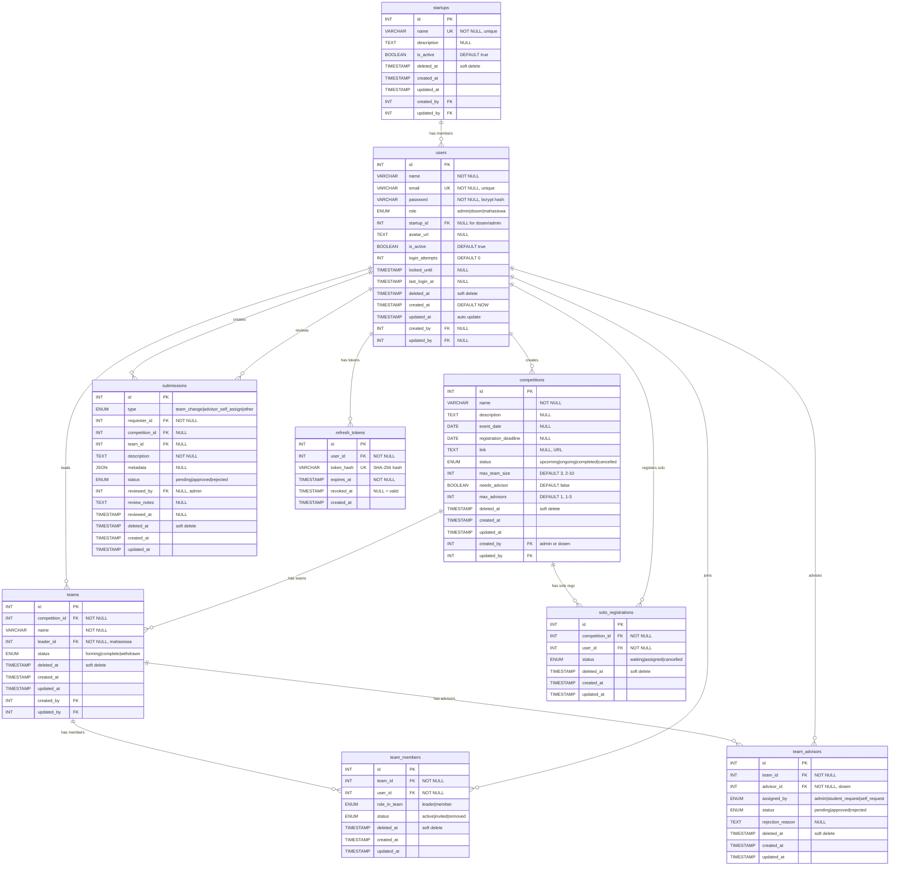

# Product Requirements Document (PRD)

# Info Lomba Ko+Lab

---

# 1. Document Info

| Field           | Value                        |
|-----------------|------------------------------|
| Project Name    | Info Lomba Ko+Lab            |
| Version         | v1.0                         |
| Status          | Draft / In Review            |
| Author          | [NAMA]                       |
| Team            | [NAMA TIM]                   |
| Created         | 24/09/2026                   |
| Last Updated    | 24/09/2026                   |
| Target Launch   | [DD/MM/YYYY]                 |

---

# 2. Overview

## 2.1 Problem Statement

Ko+Lab adalah tempat magang yang di dalamnya terdapat berbagai startup, antara lain **JagoAI**, **Kroombox**, **Uni Inside**, **JagoFarm**, **Ngolab**, dan **Sorgummi**. Setiap startup memiliki mahasiswa magang yang tersebar, dan terdapat dosen pembimbing yang membawahi kegiatan akademik maupun kompetisi. Dalam ekosistem Ko+Lab, mahasiswa dan dosen sering mengikuti berbagai kompetisi atau lomba — baik itu hackathon, UI/UX competition, business plan competition, data science challenge, dan lain-lain.

Namun, saat ini proses pengelolaan informasi lomba dan pembentukan tim dilakukan **secara manual** — melalui grup WhatsApp, spreadsheet Google Sheets, atau komunikasi langsung. Pendekatan manual ini menimbulkan beberapa masalah serius:

1. **Informasi lomba tidak terpusat dan sering tenggelam.** Ketika seorang dosen atau admin membagikan informasi lomba di grup WhatsApp, pesan tersebut cepat tenggelam oleh chat lain. Tidak ada satu tempat khusus di mana semua anggota Ko+Lab bisa melihat daftar lomba yang tersedia, deadline pendaftaran, atau status lomba tersebut.

2. **Pembentukan tim lomba tidak efisien dan tidak transparan.** Mahasiswa yang ingin ikut lomba tetapi belum punya tim harus mencari anggota secara manual — bertanya di grup atau langsung ke teman. Proses ini tidak terstruktur dan seringkali mahasiswa akhirnya batal ikut lomba karena tidak menemukan tim. Di sisi lain, admin yang ingin menyesuaikan tim harus mengumpulkan data dari chat yang berantakan.

3. **Penunjukan dosen pembimbing tidak terkelola dengan baik.** Ketika sebuah tim lomba membutuhkan dosen pembimbing, proses pengajuannya dilakukan via chat pribadi atau langsung. Tidak ada mekanisme formal di mana mahasiswa bisa mengajukan dosen yang diinginkan, dosen bisa mempertimbangkan dan merespons (accept/reject), dan admin bisa memantau siapa yang sudah/belum punya pembimbing.

4. **Tidak ada tracking history lomba.** Tidak ada catatan terstruktur siapa saja yang pernah mengikuti lomba apa, kapan, dengan tim siapa, dan apa hasilnya. Ketika ada lomba baru yang mirip dengan lomba sebelumnya, tidak ada data referensi untuk menentukan siapa yang cocok untuk di-rekrut.

5. **Tidak ada visibility partisipasi antar anggota.** Sesama mahasiswa maupun dosen tidak bisa melihat siapa yang sedang aktif mengikuti lomba dan siapa yang belum. Hal ini menyulitkan koordinasi dan rekrutmen anggota tim.

### Core Pain Points:
- Informasi lomba tersebar di berbagai channel chat dan cepat tenggelam
- Proses pembentukan tim lomba manual, tidak terstruktur, dan tidak transparan
- Pengajuan dosen pembimbing dilakukan via chat pribadi tanpa tracking
- Tidak ada history partisipasi lomba untuk referensi di masa depan
- Admin kesulitan memantau status seluruh tim dan pengajuan yang masuk
- Mahasiswa yang belum punya tim sering batal ikut lomba karena tidak ada mekanisme matching

---

## 2.2 Proposed Solution

Membangun sebuah **aplikasi web berbasis browser** bernama **"Info Lomba Ko+Lab"** yang menjadi platform terpusat untuk seluruh aktivitas terkait lomba di lingkungan Ko+Lab. Aplikasi ini mendukung **3 role pengguna**:

1. **Admin** — memiliki akses penuh terhadap seluruh fitur: mengelola user, startup, informasi lomba, menyesuaikan tim, menetapkan dosen pembimbing, dan memantau seluruh pengajuan.
2. **Dosen** — bisa menambah informasi lomba, melihat dan merespons pengajuan menjadi dosen pembimbing, mengajukan perubahan tim ke admin, serta melihat history lomba yang dibimbing.
3. **Mahasiswa** — bisa mendaftar lomba (dengan atau tanpa tim), membuat tim dan menambah anggota, mengajukan dosen pembimbing, serta melihat history lomba yang diikuti.

Aplikasi ini akan menjadi **single source of truth** untuk semua informasi lomba, pembentukan tim, pengelolaan dosen pembimbing, dan tracking history partisipasi di Ko+Lab.

---

## 2.3 Value Proposition

| Untuk                         | Yang                                                         | Kami menawarkan        | Tidak seperti                    | Karena                                                              |
|-------------------------------|--------------------------------------------------------------|------------------------|----------------------------------|---------------------------------------------------------------------|
| Mahasiswa & Dosen Ko+Lab      | Kesulitan mencari info lomba, membentuk tim, dan koordinasi  | Info Lomba Ko+Lab      | Chat WA / Spreadsheet manual     | Terpusat, real-time, ada workflow approval, ada history partisipasi  |

**Positioning Statement:**
"Info Lomba Ko+Lab adalah platform manajemen informasi dan partisipasi lomba untuk seluruh anggota Ko+Lab (mahasiswa, dosen, dan admin) yang ingin proses pendaftaran lomba, pembentukan tim, dan pengelolaan dosen pembimbing yang terstruktur dan transparan. Tidak seperti komunikasi manual melalui WhatsApp dan spreadsheet yang berantakan dan tidak ter-track, kami menyediakan satu tempat terpusat dengan workflow approval, history lomba, dan monitoring real-time."

---

## 2.4 Competitive Landscape

| Kompetitor          | Kelebihan Mereka                                    | Kelemahan Mereka                                                   | Differensiasi Kita                                                              |
|---------------------|------------------------------------------------------|--------------------------------------------------------------------|---------------------------------------------------------------------------------|
| Chat WhatsApp / Telegram | Gratis, semua orang sudah pakai, real-time       | Informasi cepat tenggelam, tidak terstruktur, tidak ada search     | Informasi terpusat, bisa di-search dan filter, ada arsip permanen               |
| Google Sheets       | Gratis, bisa kolaborasi, familiar                   | Tidak ada workflow approval, tidak ada notifikasi otomatis, tidak ada role-based access | Ada workflow approval (pengajuan → approve/reject), role-based access, dashboard per role |
| Microsoft Teams / Notion | Terstruktur, bisa kolaborasi                    | Terlalu kompleks untuk kebutuhan sederhana, perlu learning curve   | Spesifik untuk kebutuhan lomba, UI sederhana dan fokus, tidak perlu training lama |
| Platform Lomba Eksternal (e.g. Devfolio) | Sudah terintegrasi dengan pendaftaran lomba   | Tidak bisa custom workflow, tidak mendukung struktur organisasi Ko+Lab | Custom untuk Ko+Lab, support startup, dosen pembimbing, admin monitoring        |
| Manual / Luring     | Fleksibel, tidak perlu teknologi                     | Tidak scalable, tidak ada history, error-prone, sulit tracking     | History lengkap, scalable, data terstruktur                                     |

---

## 2.5 Monetization Model

**N/A** — Aplikasi ini bersifat internal untuk kebutuhan operasional Ko+Lab, bukan produk komersial. Tidak ada model monetisasi. Aplikasi ini didanai oleh Ko+Lab dan digunakan secara gratis oleh seluruh anggota (mahasiswa, dosen, admin).

---

# 3. Assumptions

| ID    | Asumsi                                                                          | Dampak Jika Salah                                          | Verifikasi By          |
|-------|---------------------------------------------------------------------------------|------------------------------------------------------------|------------------------|
| A-01  | User mengakses aplikasi via browser web (Chrome, Firefox, Edge) di desktop dan mobile | Perlu pertimbangkan native mobile app atau PWA          | Survey user Ko+Lab     |
| A-02  | Jumlah startup di Ko+Lab bisa bertambah seiring waktu (bukan fixed 6 startup)   | Harus buat fitur kelola startup yang dinamis oleh admin    | Koordinasi dengan Ko+Lab|
| A-03  | Mahasiswa dan dosen punya akses internet stabil saat menggunakan aplikasi        | Perlu pertimbangkan offline mode atau PWA                  | Observasi lingkungan   |
| A-04  | Admin Ko+Lab (1-2 orang) bertanggung jawab atas data user dan kelola sistem     | Perlu validasi hak akses ketat, pertimbangkan super-admin  | Diskusi dengan Ko+Lab  |
| A-05  | Satu mahasiswa hanya bisa join 1 startup saat registrasi dan tidak bisa pindah  | Perlu revisi schema jika ternyata boleh multi-startup      | Konfirmasi admin       |
| A-06  | Dosen bisa membimbing di beberapa tim lomba secara bersamaan (tidak dibatasi 1 tim) | Perlu limitasi jika ternyata dosen terbatas              | Diskusi dengan dosen   |
| A-07  | Tim lomba bisa beranggotakan mahasiswa dari startup yang berbeda-beda           | Jika tidak, perlu validasi startup saat menambah anggota   | Konfirmasi admin       |
| A-08  | Satu lomba hanya boleh diikuti oleh satu tim per mahasiswa (tidak boleh double) | Perlu validasi di backend                                  | Business logic         |
| A-09  | Sistem ini tidak perlu integrasi dengan sistem akademik kampus                  | Jika perlu, scope bertambah signifikan                     | Diskusi stakeholder    |
| A-10  | Tim development terdiri dari [X] developer selama [Y] bulan                     | Scope harus dipersempit jika resource terbatas             | Konfirmasi PM          |

---

# 4. Goals & Success Metrics

## 4.1 Goals (In Scope)

1. **Terpusat:** Seluruh informasi lomba tersedia di satu platform dan bisa diakses oleh semua role (admin, dosen, mahasiswa) kapan saja.
2. **Efisien:** Mahasiswa bisa mendaftar lomba, membentuk tim, dan mengajukan dosen pembimbing secara mandiri melalui aplikasi tanpa perlu koordinasi manual.
3. **Transparan:** Admin bisa memantau seluruh aktivitas — siapa yang mendaftar lomba apa, tim mana yang belum lengkap, pengajuan apa yang pending — dari satu dashboard.
4. **Terstruktur:** Workflow pengajuan (perubuan tim, dosen pembimbing) mengikuti alur yang jelas: pengajuan → review → approve/reject.
5. **Ter-track:** History lomba setiap anggota (mahasiswa dan dosen) tercatat secara permanen dan bisa diakses oleh semua user.
6. **Mudah digunakan:** UI intuitif dan sederhana sehingga user dengan tech savvy rendah sekalipun bisa menggunakan tanpa training lama.

## 4.2 Non-Goals (Out of Scope)

| Non-Goal                                                      | Alasan                                                        |
|---------------------------------------------------------------|---------------------------------------------------------------|
| Integrasi dengan platform lomba eksternal (auto-submit)       | Terlalu kompleks, setiap platform lomba punya API berbeda     |
| Sistem pembayaran / manajemen hadiah lomba                    | Di luar scope manajemen informasi lomba                       |
| Mobile native app (Android/iOS)                               | MVP hanya web responsive, bisa diakses dari HP via browser    |
| Multi-language (EN/ID)                                        | User base hanya Indonesia                                     |
| Sistem penilaian / scoring lomba                              | Bukan platform penyelenggara lomba                            |
| Chat internal antar anggota tim                               | Bisa pakai WhatsApp/Telegram sementara                        |
| Video conference / meeting scheduler                          | Di luar scope                                                 |
| Notifikasi push / email otomatis (Phase 1)                    | Bisa komunikasi via chat, masuk Phase 2                       |
| Export PDF / Excel report (Phase 1)                           | Bisa pakai screenshot, masuk Phase 2                          |
| Analitik dashboard & statistik (Phase 1)                      | Nice-to-have, masuk Phase 2                                   |

## 4.3 MVP Boundary

**Yang MASUK MVP (harus selesai sebelum launch):**

| Feature                                              | Alasan Masuk MVP                                                    |
|------------------------------------------------------|---------------------------------------------------------------------|
| Authentication (Register, Login, Logout)             | Gate utama — tanpanya semua fitur tidak bisa diakses                |
| Register Mahasiswa dengan Pilih Startup              | Mahasiswa wajib join startup — data ini dipakai di seluruh sistem   |
| Admin CRUD User                                      | Admin harus bisa mengelola akun semua role                          |
| Admin CRUD Startup                                   | Daftar startup bisa berubah, admin harus bisa kelola                |
| Informasi Lomba CRUD (Admin & Dosen)                 | Core value utama aplikasi                                           |
| Pendaftaran Lomba (Sudah Punya Tim / Belum Punya Tim)| Fitur utama untuk mahasiswa                                         |
| Pembentukan Tim (Buat Tim + Tambah Anggota)          | Mahasiswa yang sudah punya tim harus bisa mendaftarkan timnya       |
| Admin Penyesuaian Tim (Bentuk Tim dari Solo)         | Mahasiswa tanpa tim harus bisa di-match oleh admin                  |
| Dosen Pembimbing: Pengajuan dari Mahasiswa           | Tim lomba perlu dosen pembimbing                                    |
| Dosen Pembimbing: Approve/Reject oleh Dosen          | Dosen harus bisa merespons pengajuan                                |
| Dosen Pembimbing: Penetapan Langsung oleh Admin      | Admin perlu kontrol penuh                                           |
| Dosen Pembimbing: Self-Assign oleh Dosen             | Dosen yang proaktif bisa menawarkan diri                            |
| Profil User & History Lomba                          | Semua user perlu melihat data diri dan history                      |
| Direktori Anggota (Lihat Status Partisipasi)         | Semua user perlu visibility siapa yang ikut lomba                   |
| Monitoring Pengajuan (Admin Dashboard)               | Admin perlu melihat dan merespons semua pengajuan                   |
| Dashboard per Role                                   | Entry point yang berbeda sesuai kebutuhan role                      |

**Yang TIDAK masuk MVP (ditunda ke iterasi berikutnya):**

| Feature                          | Alasan Ditunda                                    | Target Fase |
|----------------------------------|---------------------------------------------------|-------------|
| Notifikasi Email                 | Bisa komunikasi via WA dulu, perlu setup SMTP     | Phase 2     |
| Notifikasi In-App                | Bisa di-scroll manual untuk cek                   | Phase 2     |
| Export PDF / Excel               | Bisa pakai screenshot / copy-paste                | Phase 2     |
| Chat Internal antar Anggota Tim  | Bisa pakai WhatsApp/Telegram                      | Phase 3     |
| Sistem Penilaian / Review Lomba  | Di luar scope manajemen info                      | Phase 3     |
| Analitik & Statistik Dashboard   | Nice-to-have, tidak mempengaruhi core value       | Phase 2     |
| Dark Mode                        | Nice-to-have, tidak mempengaruhi core value       | Phase 3     |
| Mobile PWA                       | Bisa diakses via browser mobile dulu              | Phase 2     |
| Import User dari Excel/CSV       | Bisa input manual, user terbatas                  | Phase 2     |
| Audit Log Detail                 | Bisa cek manual di database                       | Phase 3     |
| Multi-language Support           | User base hanya Indonesia                         | Phase 3     |
| Integrasi Google Calendar        | Nice-to-have                                      | Phase 3     |
| Rekap & Report per Startup       | Bisa query manual dulu                            | Phase 2     |

**Aturan MVP:** Fitur baru yang muncul saat development otomatis masuk backlog Phase 2 kecuali ada approval eksplisit dari Product Owner disertai trade-off yang jelas (fitur lain keluar dari sprint yang sama).

---

## 4.4 Product Metrics (Business KPI)

| Metrik                              | Baseline | Target (30 hari) | Target (90 hari) | Cara Ukur             |
|-------------------------------------|----------|-------------------|-------------------|-----------------------|
| Registered Users                    | 0        | 30 user           | 100 user          | Database count        |
| Daily Active Users (DAU)            | -        | 10 user           | 30 user           | Login tracking        |
| Monthly Active Users (MAU)          | -        | 25 user           | 80 user           | Login tracking        |
| Lomba Terdaftar di Sistem           | 0        | 5 lomba           | 15 lomba          | Database count        |
| Tim Terbentuk                       | 0        | 10 tim            | 30 tim            | Database count        |
| Pengajuan Dosen Pembimbing          | 0        | 5 pengajuan       | 20 pengajuan      | Submission count      |
| Feature Adoption (Pendaftaran Lomba)| -        | > 60% user aktif  | > 80% user aktif  | Event tracking        |

## 4.5 Technical Metrics (Engineering KPI)

| Metrik                      | Target       | Cara Ukur                  |
|-----------------------------|--------------|----------------------------|
| API Response Time (p50)     | < 100ms      | Server-side logging        |
| API Response Time (p95)     | < 300ms      | Server-side logging        |
| API Response Time (p99)     | < 500ms      | Server-side logging        |
| App Cold Start Time         | < 2 detik    | Lighthouse / browser       |
| API Error Rate (5xx)        | < 0.5%       | Server monitoring          |
| Database Query Time (avg)   | < 50ms       | Prisma query logging       |
| Build Success Rate (CI)     | > 95%        | GitHub Actions             |
| Backend Uptime              | > 99.5%      | Uptime monitor             |
| Page Load Time (FCP)        | < 1.5 detik  | Lighthouse                 |
| Lighthouse Performance Score| > 80         | Lighthouse audit           |

---

# 5. User & Stakeholder

## 5.1 Target Users

### Persona 1: Rizky — Mahasiswa Magang

| Field        | Detail                                                                 |
|--------------|------------------------------------------------------------------------|
| Nama         | Rizky Pratama                                                          |
| Umur         | 20-24 tahun                                                            |
| Pekerjaan    | Mahasiswa semester 5-7, magang di startup JagoAI di Ko+Lab            |
| Tech Savvy   | Medium — aktif pakai smartphone dan laptop, familiar dengan web app    |
| Goals        | (1) Ingin tahu info lomba apa saja yang tersedia, (2) Ingin ikut lomba untuk pengalaman & portofolio, (3) Ingin punya tim yang solid |
| Frustrations | (1) Sering ketinggalan info lomba karena chat WA tenggelam, (2) Susah cari anggota tim karena tidak tahu siapa yang available, (3) Bingung cara ngajuin dosen pembimbing |
| Device       | Laptop (Windows) dan HP Android                                        |
| Context      | Saat jam magang (senin-jumat, 09.00-17.00) atau malam hari setelah pulang |
| Scenario     | Rizky melihat info lomba Hackathon AI di dashboard → klik detail → daftar dengan membuat tim → pilih Budi dan Siti sebagai anggota → submit → mengajukan Pak Andi sebagai dosen pembimbing → menunggu acc |

### Persona 2: Pak Andi — Dosen Pembimbing

| Field        | Detail                                                                 |
|--------------|------------------------------------------------------------------------|
| Nama         | Dr. Andi Susanto, S.Kom., M.Kom.                                      |
| Umur         | 35-50 tahun                                                            |
| Pekerjaan    | Dosen Informatika sekaligus pembimbing magang di Ko+Lab               |
| Tech Savvy   | Low-Medium — bisa pakai web browser dan email, kurang familiar dengan tools baru |
| Goals        | (1) Membimbing mahasiswa berprestasi di lomba, (2) Tahu info lomba yang relevan untuk dishare ke mahasiswa, (3) Mengelola tim yang dibimbing secara efisien |
| Frustrations | (1) Tidak tahu mahasiswa mana yang sedang ikut lomba apa, (2) Sering diminta jadi pembimbing secara dadakan via chat pribadi, (3) Tidak ada track record lomba yang pernah dibimbing |
| Device       | Laptop (Windows/Mac)                                                   |
| Context      | Di kampus saat jam kerja atau saat kunjungan ke Ko+Lab                 |
| Scenario     | Pak Andi login → melihat dashboard ada 2 pengajuan pembimbing baru → review pengajuan dari Team Alpha (Hackathon AI) → approve → melihat pengajuan dari Team Beta (Business Plan) → reject dengan alasan "sudah terlalu banyak tim" → tambah info lomba baru "Data Science Challenge 2026" |

### Persona 3: Mbak Sari — Admin Ko+Lab

| Field        | Detail                                                                 |
|--------------|------------------------------------------------------------------------|
| Nama         | Sari Dewi                                                              |
| Umur         | 25-35 tahun                                                            |
| Pekerjaan    | Admin / Koordinator operasional magang di Ko+Lab                       |
| Tech Savvy   | Medium — familiar dengan spreadsheet, chat apps, dan web dashboard     |
| Goals        | (1) Mengelola seluruh aktivitas lomba dan tim secara efisien, (2) Memantau siapa yang mengajukan apa, (3) Memastikan setiap tim lomba punya dosen pembimbing |
| Frustrations | (1) Harus koordinasi manual via chat ke banyak orang, (2) Data pendaftaran lomba berantakan di spreadsheet, (3) Tidak tahu tim mana yang belum punya dosen pembimbing |
| Device       | Laptop (Windows)                                                       |
| Context      | Jam kerja di kantor Ko+Lab (senin-jumat, 08.00-17.00)                 |
| Scenario     | Mbak Sari login → dashboard menunjukkan 3 pengajuan pending → review pengajuan perubahan tim dari Pak Andi → approve → bentuk tim untuk 5 mahasiswa yang daftar tanpa tim → tetapkan Pak Budi sebagai dosen pembimbing untuk Team Gamma → cek direktori melihat 20 user aktif |

---

## 5.2 Stakeholders

| Role              | Nama/Tim             | Kepentingan                                       |
|-------------------|----------------------|---------------------------------------------------|
| Product Owner     | [Nama]               | Decision maker fitur dan prioritas                 |
| Tech Lead         | [Nama]               | Keputusan arsitektur dan tech stack                |
| Developer         | [Nama/Tim]           | Technical implementation                           |
| Designer          | [Nama]               | UI/UX consistency                                  |
| QA                | [Nama]               | Quality assurance sebelum release                  |
| Admin Ko+Lab      | [Nama]               | End user utama, validasi workflow, feedback fitur   |
| Dosen Pembimbing  | [Nama/Nama-nama]     | End user, validasi workflow dosen                   |
| Perwakilan Mahasiswa | [Nama]            | End user, validasi UI/UX mahasiswa                  |
| Koordinator Ko+Lab| [Nama]               | Approval budget, timeline, dan scope                |

---

## 5.3 RACI Matrix

| Aktivitas                       | Product Owner | Tech Lead | Developer | Designer | QA  |
|---------------------------------|:---:|:---:|:---:|:---:|:---:|
| Mendefinisikan requirements     | A   | C   | C   | C   | I   |
| Prioritas fitur & MVP scope     | A   | C   | I   | I   | I   |
| Keputusan arsitektur            | C   | A   | C   | I   | I   |
| Pemilihan tech stack            | C   | A   | C   | I   | I   |
| Implementasi backend            | I   | C   | A   | I   | I   |
| Implementasi frontend           | I   | C   | A   | R   | I   |
| UI/UX design                    | C   | I   | I   | A   | I   |
| Code review                     | I   | A   | R   | I   | I   |
| Testing & QA                    | I   | C   | C   | I   | A   |
| Deployment ke staging           | I   | A   | R   | I   | C   |
| Deployment ke production        | A   | C   | R   | I   | C   |
| Dokumentasi API                 | I   | C   | A   | I   | I   |
| Demo ke stakeholder             | A   | C   | I   | C   | I   |

---

# 6. Features & Requirements

## 6.1 Feature Priority (MoSCoW)

| Priority | Label       | Arti                                                            |
|----------|-------------|-----------------------------------------------------------------|
| P0       | Must Have   | Wajib ada — tanpa ini MVP tidak bisa dirilis                    |
| P1       | Should Have | Penting, tapi bisa dirilis tanpa ini di fase pertama            |
| P2       | Could Have  | Nice-to-have, masuk backlog setelah MVP                         |
| P3       | Won't Have  | Di-skip untuk saat ini, pertimbangkan untuk fase mendatang      |

---

## 6.2 Feature List

| ID   | Feature                                       | Priority | Status   | PIC    | Notes                                                       |
|------|-----------------------------------------------|----------|----------|--------|-------------------------------------------------------------|
| F-01 | Authentication (Register, Login, Logout)       | P0       | Todo     | [Nama] | Register dengan pilih startup (mahasiswa)                   |
| F-02 | Dashboard per Role (Admin, Dosen, Mahasiswa)   | P0       | Todo     | [Nama] | Tampilan dan ringkasan beda per role                        |
| F-03 | Manajemen User oleh Admin (CRUD)               | P0       | Todo     | [Nama] | Tambah, edit, nonaktifkan, search, filter                   |
| F-04 | Manajemen Startup oleh Admin (CRUD)            | P0       | Todo     | [Nama] | Tambah, edit, hapus startup                                 |
| F-05 | Informasi Lomba (CRUD oleh Admin & Dosen)      | P0       | Todo     | [Nama] | Admin bisa semua, dosen bisa tambah & edit milik sendiri    |
| F-06 | Pendaftaran Lomba oleh Mahasiswa               | P0       | Todo     | [Nama] | Pilih status: sudah punya tim / belum punya tim             |
| F-07 | Pembentukan Tim oleh Mahasiswa (Sudah Punya)   | P0       | Todo     | [Nama] | Buat tim + tambah anggota dari daftar user terdaftar        |
| F-08 | Penyesuaian Tim oleh Admin (Belum Punya Tim)   | P0       | Todo     | [Nama] | Admin bentuk tim dari mahasiswa solo                         |
| F-09 | Admin Kelola Tim (Edit, Bubar, Tambah Anggota) | P0       | Todo     | [Nama] | Full control admin atas semua tim                            |
| F-10 | Pengajuan Dosen Pembimbing oleh Ketua Tim      | P0       | Todo     | [Nama] | Ketua pilih dosen → dosen acc/reject                        |
| F-11 | Dosen Approve/Reject Pengajuan Pembimbing      | P0       | Todo     | [Nama] | Dosen bisa accept atau reject dengan alasan                  |
| F-12 | Dosen Self-Assign ke Tim                       | P0       | Todo     | [Nama] | Dosen ajukan diri → admin approve                           |
| F-13 | Admin Tetapkan Dosen Pembimbing Langsung       | P0       | Todo     | [Nama] | Admin assign dosen ke tim tanpa perlu pengajuan             |
| F-14 | Dosen Ajukan Perubahan Tim ke Admin            | P0       | Todo     | [Nama] | Dosen bisa request perubahan komposisi tim → admin acc      |
| F-15 | Profil User & Edit Profil                      | P0       | Todo     | [Nama] | Lihat data diri, edit nama & foto                           |
| F-16 | History Lomba (Riwayat Partisipasi)            | P0       | Todo     | [Nama] | Lihat lomba yang pernah/sedang diikuti                      |
| F-17 | Direktori Anggota & Status Partisipasi         | P0       | Todo     | [Nama] | Lihat semua user, filter, search, status ikut lomba         |
| F-18 | Monitoring Pengajuan oleh Admin                | P0       | Todo     | [Nama] | Halaman khusus semua pengajuan pending → acc/reject         |
| F-19 | Filter & Search Lomba                          | P1       | Backlog  | [Nama] | Filter status, search nama lomba                            |
| F-20 | Notifikasi In-App (Pengajuan Baru)             | P1       | Backlog  | [Nama] | Badge/counter di header saat ada pengajuan baru             |
| F-21 | Rekap Data per Startup                         | P1       | Backlog  | [Nama] | Statistik: berapa mahasiswa per startup yang ikut lomba     |
| F-22 | Export Data ke PDF/Excel                       | P2       | Backlog  | [Nama] | Export daftar tim, history lomba                            |
| F-23 | Notifikasi Email                               | P2       | Backlog  | [Nama] | Email saat pengajuan di-acc/reject                          |
| F-24 | Onboarding / Tutorial Singkat                  | P2       | Backlog  | [Nama] | Guided tour untuk user baru                                 |
| F-25 | Lupa Password (Reset via Email)                | P1       | Backlog  | [Nama] | Flow reset password                                         |

---

## 6.3 Functional Requirements

---

### F-01: Authentication (Register, Login, Logout)

**Deskripsi:** User bisa mendaftar akun baru, login ke aplikasi, dan logout. Mahasiswa wajib memilih startup saat registrasi. Admin bisa membuat user baru langsung tanpa user registrasi sendiri.

**Requirements:**
- ☐ User bisa register dengan mengisi: nama lengkap, email, password, konfirmasi password, dan role (mahasiswa/dosen)
- ☐ Mahasiswa WAJIB memilih startup dari dropdown saat registrasi
- ☐ Dosen TIDAK perlu memilih startup saat registrasi
- ☐ User tidak bisa memilih role "admin" saat registrasi (admin hanya bisa dibuat oleh admin lain)
- ☐ Email harus unik — tidak boleh duplikat
- ☐ Password minimal 8 karakter, harus ada minimal 1 huruf besar dan 1 angka
- ☐ Password di-hash dengan bcrypt (cost factor 12) sebelum disimpan ke database
- ☐ Setelah register berhasil, user langsung login (dapat access token + refresh token)
- ☐ User bisa login dengan email dan password
- ☐ Setelah login, user diarahkan ke dashboard sesuai role-nya
- ☐ Access token berlaku selama 1 jam, refresh token berlaku selama 7 hari
- ☐ Token rotation: setiap kali refresh, token lama di-revoke dan token baru diterbitkan
- ☐ Auto-login: jika refresh token masih valid, user tidak perlu login ulang
- ☐ Forgot password: user bisa request reset password via email (Phase 2, tapi endpoint disiapkan)
- ☐ Logout menghapus local session dan revoke refresh token di server
- ☐ Lockout: setelah 5x percobaan login gagal berturut-turut, akun terkunci selama 15 menit
- ☐ Admin bisa membuat user baru langsung dari halaman Manajemen User (tanpa user register sendiri), dengan assign role dan startup

**Acceptance Criteria:**

Scenario: Register mahasiswa berhasil
```
GIVEN  user baru mengisi form registrasi dengan data:
       - nama: "Rizky Pratama"
       - email: "rizky@example.com"
       - password: "Password123"
       - password_confirm: "Password123"
       - role: "mahasiswa"
       - startup_id: 1 (JagoAI)
WHEN   user menekan tombol "Daftar"
THEN   akun berhasil dibuat dengan role mahasiswa dan startup JagoAI
AND    user langsung login (mendapat access_token dan refresh_token)
AND    user diarahkan ke halaman dashboard mahasiswa
AND    data startup tersimpan di profil user
```

Scenario: Register mahasiswa tanpa memilih startup
```
GIVEN  user memilih role "mahasiswa"
WHEN   user tidak memilih startup dan menekan tombol "Daftar"
THEN   muncul error "Mahasiswa wajib memilih startup"
AND    form tidak ter-submit
AND    field startup di-highlight dengan error
```

Scenario: Register dengan email yang sudah terdaftar
```
GIVEN  email "rizky@example.com" sudah terdaftar di sistem
WHEN   user baru mencoba register dengan email yang sama
THEN   muncul error "Email sudah terdaftar"
AND    form tidak ter-submit
```

Scenario: Register dengan password lemah
```
GIVEN  user mengisi password "abc123" (tidak ada huruf besar)
WHEN   user menekan tombol "Daftar"
THEN   muncul error "Password harus minimal 8 karakter dengan 1 huruf besar dan 1 angka"
AND    form tidak ter-submit
```

Scenario: Register dosen berhasil
```
GIVEN  user mengisi form registrasi dengan role "dosen"
       (tidak perlu memilih startup)
WHEN   user menekan tombol "Daftar"
THEN   akun berhasil dibuat dengan role dosen
AND    user diarahkan ke halaman dashboard dosen
```

Scenario: Login berhasil
```
GIVEN  user sudah terdaftar dengan email "rizky@example.com" dan password "Password123"
WHEN   user memasukkan email dan password yang benar, lalu menekan "Login"
THEN   user diarahkan ke halaman dashboard sesuai role
AND    access_token dan refresh_token disimpan
AND    last_login_at di database ter-update
```

Scenario: Login gagal — password salah
```
GIVEN  user memasukkan email yang benar
WHEN   user memasukkan password yang salah dan menekan "Login"
THEN   muncul error "Email atau password tidak valid"
AND    user tetap di halaman login
AND    counter percobaan gagal bertambah 1
```

Scenario: Akun terkunci setelah 5x percobaan gagal
```
GIVEN  user sudah gagal login 5 kali berturut-turut
WHEN   user mencoba login lagi
THEN   muncul error "Akun terkunci sementara. Coba lagi dalam 15 menit."
AND    user tidak bisa login selama 15 menit
```

Scenario: Login dengan akun yang dinonaktifkan admin
```
GIVEN  akun user sudah dinonaktifkan oleh admin (is_active = false)
WHEN   user mencoba login dengan email dan password yang benar
THEN   muncul error "Akun Anda telah dinonaktifkan. Hubungi admin."
```

Scenario: Access token expired → auto refresh
```
GIVEN  access_token user sudah expired (lebih dari 1 jam)
WHEN   user melakukan request ke endpoint yang memerlukan auth
THEN   sistem otomatis menggunakan refresh_token untuk mendapat access_token baru
AND    request tetap berhasil tanpa perlu login ulang
```

Scenario: Refresh token expired → redirect login
```
GIVEN  refresh_token user sudah expired (lebih dari 7 hari)
WHEN   user membuka aplikasi
THEN   user di-redirect ke halaman login
AND    pesan "Sesi Anda telah berakhir. Silakan login kembali."
```

Scenario: Logout berhasil
```
GIVEN  user sedang login
WHEN   user menekan tombol "Logout"
THEN   refresh_token di-revoke di server
AND    local session dihapus
AND    user di-redirect ke halaman login
```

Scenario: Admin membuat user baru
```
GIVEN  admin di halaman Manajemen User
WHEN   admin menekan "Tambah User", mengisi form (nama, email, role=dosen), dan submit
THEN   user baru berhasil dibuat dengan password default "KoLab2026!"
AND    user baru muncul di daftar user
AND    user baru bisa login dengan password default tersebut
```

---

### F-02: Dashboard per Role

**Deskripsi:** Setiap role memiliki tampilan dashboard yang berbeda sesuai kebutuhan dan workflow masing-masing. Dashboard adalah halaman pertama yang dilihat setelah login.

**Requirements:**
- ☐ **Dashboard Admin** menampilkan:
  - Ringkasan jumlah: total user aktif, total lomba (upcoming + ongoing), total tim, total pengajuan pending
  - Daftar pengajuan pending (maks 5 terbaru) dengan tombol "Lihat Semua"
  - Daftar lomba upcoming (maks 5 terbaru)
  - Daftar tim yang belum punya dosen pembimbing (jika lomba needs_advisor=true)
  - Daftar mahasiswa yang belum punya tim (solo registrations)
  - Quick actions: Tambah User, Tambah Lomba, Tambah Startup
- ☐ **Dashboard Dosen** menampilkan:
  - Ringkasan jumlah: lomba yang diikuti (sebagai pembimbing), tim yang dibimbing, pengajuan masuk
  - Daftar pengajuan pembimbing yang masuk (pending) dengan tombol Approve/Reject cepat
  - Daftar lomba upcoming dan ongoing
  - Quick actions: Tambah Info Lomba
- ☐ **Dashboard Mahasiswa** menampilkan:
  - Status partisipasi: "Kamu sedang mengikuti X lomba" atau "Kamu belum mengikuti lomba apapun"
  - Daftar lomba yang diikuti (dengan status tim dan dosen pembimbing)
  - Daftar lomba tersedia (upcoming) dengan tombol "Daftar"
  - Notifikasi: status pengajuan dosen pembimbing (pending/approved/rejected)
  - Quick actions: Lihat Daftar Lomba, Lihat History
- ☐ Semua dashboard responsive (desktop & mobile)
- ☐ Loading state: skeleton loader saat data sedang di-fetch

**Acceptance Criteria:**

Scenario: Admin melihat dashboard
```
GIVEN  admin login dengan akun yang valid
WHEN   halaman dashboard dimuat
THEN   admin melihat:
       - Card ringkasan: "15 User Aktif", "8 Lomba", "12 Tim", "3 Pengajuan Pending"
       - Tabel pengajuan pending terbaru (nama pengaju, jenis pengajuan, tanggal)
       - Tabel lomba upcoming (nama lomba, tanggal, deadline)
       - Quick action buttons: "Tambah User", "Tambah Lomba"
```

Scenario: Dosen melihat dashboard
```
GIVEN  dosen login
WHEN   halaman dashboard dimuat
THEN   dosen melihat:
       - Card ringkasan: "3 Tim Dibimbing", "2 Pengajuan Masuk"
       - Daftar pengajuan pembimbing dari mahasiswa (nama tim, nama lomba, tombol Acc/Reject)
       - Daftar lomba upcoming
```

Scenario: Mahasiswa melihat dashboard
```
GIVEN  mahasiswa login
WHEN   halaman dashboard dimuat
THEN   mahasiswa melihat:
       - Status: "Kamu sedang mengikuti 2 lomba" (atau "belum mengikuti lomba")
       - Card lomba yang diikuti (nama lomba, nama tim, status dosen pembimbing)
       - Daftar lomba tersedia (upcoming) dengan tombol "Daftar"
```

---

### F-03: Manajemen User oleh Admin

**Deskripsi:** Admin bisa mengelola seluruh user dalam sistem — melihat daftar, menambah, mengedit, dan menonaktifkan user.

**Requirements:**
- ☐ Admin bisa melihat daftar semua user dengan informasi: nama, email, role, startup (jika mahasiswa), status aktif, tanggal registrasi
- ☐ Admin bisa filter user berdasarkan: role (admin/dosen/mahasiswa), startup, status aktif (aktif/nonaktif)
- ☐ Admin bisa search user berdasarkan nama atau email
- ☐ Admin bisa menambah user baru (dengan assign role, startup, password default)
- ☐ Admin bisa edit data user: nama, email, role, startup, status aktif
- ☐ Admin bisa menonaktifkan user (soft delete — set is_active=false)
- ☐ Admin bisa mengaktifkan kembali user yang sudah dinonaktifkan
- ☐ Data user ditampilkan dalam bentuk tabel dengan pagination
- ☐ Kolom yang ditampilkan: No, Nama, Email, Role, Startup, Status, Aksi (Edit, Nonaktifkan)
- ☐ Admin TIDAK bisa menghapus user secara permanen (hanya nonaktifkan)
- ☐ Saat admin edit role mahasiswa menjadi dosen, field startup_id di-set NULL
- ☐ Saat admin edit role menjadi mahasiswa, wajib mengisi startup_id

**Acceptance Criteria:**

Scenario: Admin melihat daftar user
```
GIVEN  admin di halaman Manajemen User
WHEN   halaman dimuat
THEN   admin melihat tabel dengan semua user yang deleted_at IS NULL
AND    tabel bisa di-sort berdasarkan nama, email, role, tanggal registrasi
AND    ada pagination jika user lebih dari 20
```

Scenario: Admin filter user berdasarkan role
```
GIVEN  admin di halaman Manajemen User
WHEN   admin memilih filter role "mahasiswa"
THEN   tabel hanya menampilkan user dengan role mahasiswa
AND    counter menunjukkan jumlah hasil filter
```

Scenario: Admin menambah dosen baru
```
GIVEN  admin di halaman Manajemen User
WHEN   admin klik "Tambah User", isi form (nama: "Dr. Budi", email: "budi@kampus.ac.id", role: "dosen"), submit
THEN   user baru berhasil dibuat dengan password default "KoLab2026!"
AND    user baru muncul di baris teratas tabel
AND    notifikasi sukses "User berhasil ditambahkan"
```

Scenario: Admin menambah mahasiswa baru tanpa startup
```
GIVEN  admin memilih role "mahasiswa"
WHEN   admin tidak mengisi startup dan submit
THEN   muncul error "Startup wajib diisi untuk mahasiswa"
```

Scenario: Admin menonaktifkan user
```
GIVEN  admin melihat daftar user
WHEN   admin klik tombol "Nonaktifkan" pada user "Rizky"
THEN   muncul konfirmasi "Nonaktifkan user Rizky Pratama?"
AND    setelah konfirmasi, status user berubah menjadi "Nonaktif"
AND    user tersebut tidak bisa login lagi
AND    tombol berubah menjadi "Aktifkan"
```

Scenario: Admin mengaktifkan kembali user
```
GIVEN  admin melihat user yang statusnya "Nonaktif"
WHEN   admin klik "Aktifkan"
THEN   status user berubah menjadi "Aktif"
AND    user bisa login kembali
```

Scenario: Admin mengedit data user
```
GIVEN  admin klik "Edit" pada user "Rizky"
WHEN   form edit terisi dengan data saat ini
AND    admin mengubah startup dari "JagoAI" ke "Kroombox"
AND    admin klik "Simpan"
THEN   data user berhasil di-update
AND    notifikasi sukses "Data user berhasil diperbarui"
```

---

### F-04: Manajemen Startup oleh Admin

**Deskripsi:** Admin bisa mengelola daftar startup di Ko+Lab. Daftar startup ini digunakan saat registrasi mahasiswa dan untuk filter di berbagai halaman.

**Requirements:**
- ☐ Admin bisa menambah startup baru (nama, deskripsi)
- ☐ Admin bisa edit nama dan deskripsi startup
- ☐ Admin bisa menghapus startup (soft delete)
- ☐ Daftar startup yang aktif ditampilkan di dropdown saat registrasi mahasiswa
- ☐ Daftar startup ditampilkan di halaman direktori sebagai filter
- ☐ Nama startup harus unik
- ☐ Saat startup dihapus, user yang terdaftar di startup tersebut startup_id-nya menjadi NULL (ON DELETE SET NULL)
- ☐ Admin bisa melihat berapa user yang terdaftar di setiap startup

**Acceptance Criteria:**

Scenario: Admin menambah startup baru
```
GIVEN  admin di halaman Manajemen Startup
WHEN   admin mengisi nama "StartupBaru" dan deskripsi "Deskripsi startup baru", submit
THEN   startup baru berhasil dibuat dan muncul di daftar
AND    startup baru tersedia di dropdown registrasi mahasiswa
```

Scenario: Admin menghapus startup yang masih punya user
```
GIVEN  startup "JagoAI" memiliki 5 mahasiswa terdaftar
WHEN   admin menghapus startup "JagoAI"
THEN   muncul peringatan "JagoAI memiliki 5 anggota. Menghapus startup akan mengosongkan field startup mereka."
AND    setelah konfirmasi, startup di-soft delete
AND    startup_id kelima mahasiswa tersebut menjadi NULL
```

---

### F-05: Informasi Lomba (CRUD oleh Admin & Dosen)

**Deskripsi:** Admin dan Dosen bisa menambah informasi lomba. Semua user bisa melihat daftar lomba dan detail lomba. Admin punya akses penuh (CRUD semua lomba), dosen hanya bisa tambah dan edit milik sendiri.

**Requirements:**
- ☐ **Admin** bisa menambah, edit, dan menghapus (soft delete) semua lomba
- ☐ **Dosen** bisa menambah lomba baru, dan mengedit lomba yang ia buat sendiri (tidak bisa edit lomba buatan admin/dosen lain)
- ☐ **Dosen** TIDAK bisa menghapus lomba (hanya admin)
- ☐ Form tambah lomba berisi:
  - Nama lomba (wajib, max 255 karakter)
  - Deskripsi (opsional, max 5000 karakter, support markdown sederhana)
  - Tanggal pelaksanaan (opsional)
  - Deadline pendaftaran (opsional, harus >= hari ini)
  - Link informasi lomba (opsional, URL ke website lomba)
  - Status (upcoming / ongoing / completed / cancelled, default: upcoming)
  - Maksimal anggota per tim (wajib, default: 3, min: 2, max: 10)
  - Apakah memerlukan dosen pembimbing (checkbox, default: false)
  - Maksimal dosen pembimbing per tim (wajib jika needs_advisor=true, default: 1, max: 3)
- ☐ Semua user bisa melihat daftar lomba (card view atau list view)
- ☐ Detail lomba menampilkan: semua field di atas + daftar tim yang sudah terdaftar + jumlah slot tersisa
- ☐ Ada indikator visual untuk status lomba (badge warna: hijau=upcoming, biru=ongoing, abu=completed, merah=cancelled)
- ☐ Lomba yang statusnya "completed" atau "cancelled" tidak bisa didaftar oleh mahasiswa

**Acceptance Criteria:**

Scenario: Dosen menambah lomba baru
```
GIVEN  dosen login dan di halaman Informasi Lomba
WHEN   dosen klik "Tambah Lomba", mengisi form:
       - Nama: "Hackathon AI 2026"
       - Deskripsi: "Kompetisi membuat solusi AI untuk masalah nyata"
       - Tanggal pelaksanaan: 2026-12-15
       - Deadline pendaftaran: 2026-12-01
       - Maksimal anggota per tim: 4
       - Perlu dosen pembimbing: Ya
       - Maks dosen pembimbing: 1
       Dan klik "Simpan"
THEN   lomba baru berhasil dibuat
AND    status otomatis "upcoming"
AND    lomba muncul di daftar lomba untuk semua user
AND    di detail lomba tercatat "Ditambahkan oleh: Dr. Andi Susanto"
```

Scenario: Dosen mencoba mengedit lomba milik admin
```
GIVEN  dosen melihat daftar lomba
WHEN   dosen klik lomba yang dibuat oleh admin
THEN   tombol "Edit" tidak muncul / disabled
AND    dosen hanya bisa melihat detail
```

Scenario: Dosen mengedit lomba milik sendiri
```
GIVEN  dosen yang membuat lomba "Hackathon AI 2026"
WHEN   dosen klik "Edit" dan mengubah deadline pendaftaran ke 2026-12-05
THEN   lomba berhasil di-update
```

Scenario: Admin menghapus lomba
```
GIVEN  admin melihat daftar lomba
WHEN   admin klik "Hapus" pada lomba "Data Science Challenge"
THEN   muncul konfirmasi "Hapus lomba ini? Semua tim dan pendaftaran akan ikut terhapus."
AND    setelah konfirmasi, lomba di-soft delete
AND    tim dan pendaftaran terkait juga di-soft delete
```

Scenario: Mahasiswa melihat daftar lomba
```
GIVEN  mahasiswa login
WHEN   mahasiswa buka halaman Informasi Lomba
THEN   mahasiswa melihat daftar lomba dengan:
       - Badge status (upcoming/ongoing/completed/cancelled)
       - Nama lomba, tanggal, deadline
       - Jumlah tim terdaftar
       - Tombol "Daftar" (hanya untuk status upcoming)
       - Tombol "Lihat Detail"
```

Scenario: Mahasiswa melihat detail lomba
```
GIVEN  mahasiswa klik detail lomba "Hackathon AI 2026"
WHEN   halaman detail dimuat
THEN   mahasiswa melihat:
       - Semua informasi lomba (nama, deskripsi, tanggal, dll)
       - Daftar tim yang sudah terdaftar (nama tim, anggota, dosen pembimbing)
       - Jumlah slot tersisa (jika ada batasan)
       - Status apakah mahasiswa ini sudah terdaftar atau belum
       - Tombol "Daftar Lomba Ini" (jika belum terdaftar dan lomba upcoming)
```

---

### F-06: Pendaftaran Lomba oleh Mahasiswa

**Deskripsi:** Mahasiswa bisa mendaftar ke lomba yang statusnya "upcoming". Saat mendaftar, mahasiswa memilih apakah sudah punya tim atau belum. Jika sudah punya tim, mahasiswa membuat tim dan menambah anggota. Jika belum, admin akan menyesuaikan nanti.

**Requirements:**
- ☐ Mahasiswa bisa mendaftar ke lomba yang statusnya "upcoming" (belum melewati deadline pendaftaran)
- ☐ Mahasiswa hanya bisa mendaftar 1x per lomba (tidak boleh double)
- ☐ Saat mendaftar, mahasiswa memilih: "Sudah Punya Tim" atau "Belum Punya Tim"
- ☐ **Jika "Sudah Punya Tim":**
  - Mahasiswa (yang mendaftar = otomatis ketua) mengisi nama tim
  - Mahasiswa menambahkan anggota dari dropdown/search daftar mahasiswa yang terdaftar di sistem
  - Anggota yang ditambahkan harus: (a) punya akun aktif, (b) belum terdaftar di lomba yang sama
  - Jumlah anggota (termasuk ketua) tidak boleh melebihi max_team_size lomba
  - Minimal 1 anggota (selain ketua)
  - Setelah submit, tim langsung terdaftar di lomba
  - Anggota yang ditambahkan mendapat status "invited" (bisa jadi fitur Phase 2 untuk konfirmasi)
- ☐ **Jika "Belum Punya Tim":**
  - Mahasiswa submit pendaftaran saja tanpa membuat tim
  - Status berubah menjadi "waiting" (menunggu admin menyesuaikan)
  - Mahasiswa muncul di daftar "Solo Registrations" yang bisa dilihat admin
- ☐ Mahasiswa bisa membatalkan pendaftaran (jika lomba belum ongoing)
- ☐ Jika lomba needs_advisor=true, mahasiswa bisa langsung mengajukan dosen pembimbing saat daftar (opsional, bisa juga setelah tim terbentuk)

**Acceptance Criteria:**

Scenario: Mahasiswa daftar lomba dengan membuat tim
```
GIVEN  mahasiswa Rizky (startup: JagoAI) melihat lomba "Hackathon AI 2026" (max_team_size: 4)
WHEN   Rizky klik "Daftar", memilih "Sudah Punya Tim"
AND    mengisi nama tim: "Team Alpha"
AND    menambah anggota: Budi (mahasiswa, Kroombox) dan Siti (mahasiswa, Uni Inside)
AND    klik "Daftar Sekarang"
THEN   tim "Team Alpha" berhasil dibuat dengan:
       - Rizky sebagai ketua (leader)
       - Budi dan Siti sebagai anggota (member)
       - Status tim: "forming"
AND    tim terdaftar di lomba "Hackathon AI 2026"
AND    Rizky melihat halaman sukses "Berhasil mendaftar! Tim: Team Alpha"
AND    Budi dan Siti muncul di daftar anggota tim
```

Scenario: Mahasiswa daftar lomba tanpa tim
```
GIVEN  mahasiswa Rizky melihat lomba "UI/UX Design Competition"
WHEN   Rizky klik "Daftar", memilih "Belum Punya Tim", dan klik "Daftar"
THEN   Rizky terdaftar di lomba dengan status "waiting"
AND    muncul pesan "Kamu telah terdaftar. Tim akan disesuaikan oleh admin."
AND    Rizky muncul di daftar solo registrations yang bisa dilihat admin
```

Scenario: Mahasiswa daftar lomba yang sudah diikuti
```
GIVEN  Rizky sudah terdaftar di lomba "Hackathon AI 2026"
WHEN   Rizky mencoba mendaftar lagi
THEN   tombol "Daftar" tidak muncul / disabled
AND    muncul badge "Sudah Terdaftar"
```

Scenario: Mahasiswa daftar lomba yang sudah melewati deadline
```
GIVEN  lomba "Data Science Challenge" deadline pendaftaran sudah lewat (2026-11-01, sekarang 2026-11-15)
WHEN   Rizky mencoba mendaftar
THEN   tombol "Daftar" disabled
AND    muncul info "Pendaftaran sudah ditutup"
```

Scenario: Mahasiswa tambah anggota yang sudah terdaftar di lomba yang sama
```
GIVEN  Budi sudah terdaftar di "Hackathon AI 2026" (di tim lain)
WHEN   Rizky mencoba menambah Budi ke Team Alpha
THEN   muncul error "Budi sudah terdaftar di lomba ini di tim lain"
AND    Budi tidak ditambahkan
```

Scenario: Mahasiswa tambah anggota melebihi batas
```
GIVEN  lomba "Hackathon AI 2026" max_team_size = 4
AND    Team Alpha sudah punya 4 anggota (termasuk ketua)
WHEN   Rizky mencoba menambah anggota ke-5
THEN   muncul error "Tim sudah penuh. Maksimal 4 anggota."
```

Scenario: Mahasiswa membatalkan pendaftaran
```
GIVEN  Rizky terdaftar di lomba "Hackathon AI 2026" (status upcoming)
WHEN   Rizky klik "Batalkan Pendaftaran"
THEN   muncul konfirmasi "Batalkan pendaftaran di Hackathon AI 2026?"
AND    setelah konfirmasi, tim "Team Alpha" di-soft delete
AND    Rizky tidak lagi terdaftar di lomba tersebut
```

---

### F-07: Pembentukan Tim oleh Mahasiswa yang Sudah Punya Tim

**Deskripsi:** Detail lebih lanjut tentang proses pembentukan tim oleh mahasiswa yang memilih "Sudah Punya Tim" saat mendaftar lomba.

**Requirements:**
- ☐ Ketua tim (mahasiswa yang mendaftar) bisa mengelola tim setelah terdaftar
- ☐ Ketua bisa menambah anggota baru ke tim (selama belum melebihi max_team_size)
- ☐ Ketua bisa menghapus anggota dari tim (selama tim belum di-approve / lomba belum ongoing)
- ☐ Ketua bisa mengganti nama tim
- ☐ Ketua bisa mengajukan dosen pembimbing (F-10)
- ☐ Setiap anggota tim bisa melihat detail tim (siapa ketua, siapa anggota, siapa dosen pembimbing)
- ☐ Hanya ketua yang bisa mengelola anggota (anggota biasa tidak bisa menambah/menghapus anggota)
- ☐ Admin bisa mengelola tim dari halaman Manajemen Tim (F-09)

**Acceptance Criteria:**

Scenario: Ketua menambah anggota setelah tim terbentuk
```
GIVEN  Team Alpha sudah terdaftar di "Hackathon AI 2026" dengan 3 anggota (max: 4)
WHEN   Rizky (ketua) klik "Tambah Anggota" dan memilih Dian
THEN   Dian berhasil ditambahkan ke Team Alpha
AND    jumlah anggota sekarang 4
```

Scenario: Ketua menghapus anggota
```
GIVEN  Team Alpha punya anggota: Rizky (ketua), Budi, Siti
WHEN   Rizky klik "Hapus" pada Budi
THEN   muncul konfirmasi "Hapus Budi dari Team Alpha?"
AND    setelah konfirmasi, Budi dihapus dari tim
AND    Budi tidak lagi terdaftar di lomba "Hackathon AI 2026" (kecuali daftar ulang)
```

Scenario: Anggota biasa mencoba mengelola tim
```
GIVEN  Budi adalah anggota (bukan ketua) di Team Alpha
WHEN   Budi melihat halaman Team Alpha
THEN   tombol "Tambah Anggota" dan "Hapus" tidak muncul untuk Budi
AND    Budi hanya bisa melihat informasi tim
```

---

### F-08: Penyesuaian Tim oleh Admin (Mahasiswa Tanpa Tim)

**Deskripsi:** Admin bisa membentuk tim untuk mahasiswa yang mendaftar lomba tanpa tim (solo registrations). Ini adalah fitur kunci yang membedakan aplikasi ini dari proses manual.

**Requirements:**
- ☐ Admin bisa melihat daftar mahasiswa yang mendaftar lomba tanpa tim (solo registrations), filter per lomba
- ☐ Admin bisa memilih beberapa mahasiswa dari daftar solo registrations
- ☐ Admin bisa membuat tim baru untuk mereka: mengisi nama tim, memilih ketua, menambah anggota
- ☐ Admin bisa juga memasukkan mahasiswa solo ke tim yang sudah ada
- ☐ Setelah admin membentuk/menyesuaikan tim, status solo registration berubah menjadi "assigned"
- ☐ Mahasiswa yang sudah di-assign ke tim mendapat notifikasi (Phase 2) atau bisa dicek di dashboard

**Acceptance Criteria:**

Scenario: Admin membentuk tim baru dari solo registrations
```
GIVEN  di lomba "Hackathon AI 2026" ada 3 mahasiswa tanpa tim:
       - Dian (startup: JagoFarm)
       - Eka (startup: Ngolab)
       - Fajar (startup: Sorgummi)
WHEN   admin klik "Bentuk Tim Baru"
AND    mengisi nama tim: "Team Omega"
AND    memilih Dian sebagai ketua
AND    menambah Eka dan Fajar sebagai anggota
AND    klik "Buat Tim"
THEN   tim "Team Omega" berhasil dibuat
AND    ketiga mahasiswa terdaftar di lomba
AND    status solo registration ketiganya berubah menjadi "assigned"
AND    Dian, Eka, dan Fajar bisa melihat tim di dashboard mereka
```

Scenario: Admin memasukkan mahasiswa solo ke tim yang sudah ada
```
GIVEN  ada 1 mahasiswa solo (Gina) di lomba "Hackathon AI 2026"
AND    ada tim "Team Alpha" yang baru punya 3 anggota (max: 4)
WHEN   admin klik "Tambah ke Tim" pada Gina, memilih "Team Alpha"
THEN   Gina ditambahkan ke Team Alpha
AND    status Gina berubah menjadi "assigned"
AND    jumlah anggota Team Alpha sekarang 4
```

---

### F-09: Admin Kelola Tim (Edit, Bubar, Tambah Anggota)

**Deskripsi:** Admin memiliki kontrol penuh atas semua tim — bisa edit komposisi, menambah/mengganti anggota, membubarkan tim, dan menunjuk ketua.

**Requirements:**
- ☐ Admin bisa melihat daftar semua tim (filter per lomba)
- ☐ Admin bisa melihat detail setiap tim (anggota, dosen pembimbing, status)
- ☐ Admin bisa menambah anggota ke tim yang sudah ada
- ☐ Admin bisa menghapus anggota dari tim
- ☐ Admin bisa mengganti ketua tim
- ☐ Admin bisa mengganti nama tim
- ☐ Admin bisa membubarkan tim (soft delete — semua anggota keluar dari lomba)
- ☐ Admin bisa melihat tim mana yang belum punya dosen pembimbing (jika lomba needs_advisor=true)
- ☐ Ada filter: tim lengkap / belum lengkap, sudah punya dosen / belum

**Acceptance Criteria:**

Scenario: Admin menambah anggota ke tim
```
GIVEN  admin melihat detail "Team Alpha" (3 anggota, max: 4)
WHEN   admin klik "Tambah Anggota", pilih "Hana", submit
THEN   Hana berhasil ditambahkan ke Team Alpha
```

Scenario: Admin mengganti ketua tim
```
GIVEN  admin melihat detail "Team Alpha" (ketua: Rizky)
WHEN   admin klik "Ganti Ketua", pilih "Budi", konfirmasi
THEN   Budi menjadi ketua baru, Rizky menjadi anggota biasa
```

Scenario: Admin membubarkan tim
```
GIVEN  admin melihat daftar tim
WHEN   admin klik "Bubarkan Tim" pada "Team Omega"
THEN   muncul konfirmasi "Bubarkan Team Omega? Semua anggota akan keluar dari lomba."
AND    setelah konfirmasi, tim di-soft delete
AND    semua team_members dihapus
AND    status solo_registration anggota (jika ada) kembali ke "waiting" atau dihapus
```

---

### F-10: Pengajuan Dosen Pembimbing oleh Ketua Tim

**Deskripsi:** Ketua tim bisa mengajukan dosen pembimbing untuk timnya. Ketua memilih dosen dari daftar dosen yang terdaftar di sistem, dan pengajuan masuk ke dosen tersebut.

**Requirements:**
- ☐ Hanya ketua tim yang bisa mengajukan dosen pembimbing
- ☐ Ketua bisa mengajukan dosen pembimbing dari dropdown daftar dosen yang aktif di sistem
- ☐ Satu tim bisa mengajukan beberapa dosen (sampai max_advisors yang ditentukan lomba)
- ☐ Ketua tidak bisa mengajukan dosen yang sudah menolak pengajuan dari tim yang sama
- ☐ Ketua bisa membatalkan pengajuan yang masih status "pending"
- ☐ Pengajuan yang sudah "approved" tidak bisa dibatalkan (harus admin yang ganti)
- ☐ Dosen yang di-ajukan muncul di daftar pengajuan masuk dosen

**Acceptance Criteria:**

Scenario: Ketua mengajukan dosen pembimbing
```
GIVEN  Rizky (ketua Team Alpha) di lomba "Hackathon AI 2026" (needs_advisor=true, max_advisors=1)
WHEN   Rizky klik "Ajukan Dosen Pembimbing"
AND    memilih "Dr. Andi Susanto" dari dropdown
AND    klik "Ajukan"
THEN   pengajuan berhasil dibuat dengan status "pending"
AND    pengajuan muncul di daftar pengajuan Pak Andi
AND    Rizky melihat status pengajuan: "Menunggu respons dari Dr. Andi Susanto"
```

Scenario: Ketua mengajukan dosen yang sudah di-approve
```
GIVEN  Team Alpha sudah punya Pak Andi sebagai dosen pembimbing (status approved)
AND    max_advisors = 1
WHEN   Rizky mencoba mengajukan dosen lain
THEN   muncul error "Tim sudah memiliki jumlah dosen pembimbing maksimal (1)"
```

Scenario: Ketua mengajukan dosen yang sudah menolak
```
GIVEN  Pak Budi sudah menolak pengajuan dari Team Alpha
WHEN   Rizky mencoba mengajukan Pak Budi lagi
THEN   muncul error "Dosen ini sudah menolak pengajuan dari tim kamu"
```

Scenario: Ketua membatalkan pengajuan pending
```
GIVEN  pengajuan ke Pak Andi masih status "pending"
WHEN   Rizky klik "Batalkan Pengajuan"
THEN   pengajuan dihapus
AND    Pak Andi tidak lagi melihat pengajuan ini
```

---

### F-11: Dosen Approve/Reject Pengajuan Pembimbing

**Deskripsi:** Dosen bisa melihat daftar pengajuan yang masuk dan merespons (approve atau reject).

**Requirements:**
- ☐ Dosen bisa melihat daftar pengajuan pembimbing yang masuk (filter: pending, approved, rejected, semua)
- ☐ Daftar menampilkan: nama tim, nama lomba, nama ketua, tanggal pengajuan
- ☐ Dosen bisa klik "Approve" untuk menerima pengajuan
- ☐ Dosen bisa klik "Reject" dengan mengisi alasan penolakan (wajib)
- ☐ Setelah approve, dosen resmi menjadi pembimbing tim tersebut
- ☐ Setelah reject, ketua tim mendapat status "rejected" beserta alasan
- ☐ Dosen bisa melihat daftar tim yang sudah ia bimbing

**Acceptance Criteria:**

Scenario: Dosen approve pengajuan
```
GIVEN  Pak Andi melihat pengajuan dari Team Alpha (Hackathon AI 2026)
WHEN   Pak Andi klik "Approve"
THEN   muncul konfirmasi "Terima pengajuan dari Team Alpha?"
AND    setelah konfirmasi, status pengajuan berubah "approved"
AND    Pak Andi resmi menjadi dosen pembimbing Team Alpha
AND    pengajuan hilang dari daftar "Pending"
AND    Pak Andi muncul di daftar dosen pembimbing di detail Team Alpha
```

Scenario: Dosen reject pengajuan
```
GIVEN  Pak Andi melihat pengajuan dari Team Beta (Business Plan Competition)
WHEN   Pak Andi klik "Reject"
AND    mengisi alasan: "Saya sudah membimbing 3 tim, tidak bisa tambah lagi"
AND    klik "Tolak"
THEN   status pengajuan berubah "rejected"
AND    ketua Team Beta melihat status "Ditolak" beserta alasan
```

---

### F-12: Dosen Self-Assign ke Tim

**Deskripsi:** Dosen bisa mengajukan diri untuk menjadi pembimbing di suatu tim tanpa diminta oleh ketua. Pengajuan ini perlu approval dari admin.

**Requirements:**
- ☐ Dosen bisa melihat daftar tim yang belum punya dosen pembimbing (di lomba yang needs_advisor=true)
- ☐ Dosen bisa klik "Ajukan Diri" pada tim tertentu
- ☐ Pengajuan masuk ke daftar submissions admin sebagai type "advisor_self_assign"
- ☐ Admin bisa approve atau reject pengajuan dosen
- ☐ Setelah admin approve, dosen resmi menjadi pembimbing tim tersebut
- ☐ Dosen tidak bisa mengajukan diri ke tim yang sudah punya dosen pembimbing maksimal

**Acceptance Criteria:**

Scenario: Dosen mengajukan diri ke tim
```
GIVEN  Pak Andi melihat daftar tim di lomba "Hackathon AI 2026"
AND    Team Gamma belum punya dosen pembimbing
WHEN   Pak Andi klik "Ajukan Diri" pada Team Gamma
THEN   pengajuan masuk ke admin dengan type "advisor_self_assign"
AND    status: "pending"
AND    Pak Andi melihat pesan "Pengajuan dikirim. Menunggu persetujuan admin."
```

Scenario: Admin approve self-assign
```
GIVEN  admin melihat pengajuan dari Pak Andi untuk membimbing Team Gamma
WHEN   admin klik "Approve"
THEN   Pak Andi resmi menjadi pembimbing Team Gamma
AND    Pak Andi dan ketua Team Gamma mendapat informasi
```

---

### F-13: Admin Tetapkan Dosen Pembimbing Langsung

**Deskripsi:** Admin bisa langsung menetapkan dosen pembimbing ke suatu tim tanpa perlu pengajuan dari mahasiswa atau dosen.

**Requirements:**
- ☐ Admin bisa dari halaman detail tim klik "Tetapkan Dosen Pembimbing"
- ☐ Admin memilih dosen dari dropdown
- ☐ Dosen langsung ditetapkan sebagai pembimbing (status: approved, assigned_by: admin)
- ☐ Dosen dan ketua tim mendapat informasi

**Acceptance Criteria:**

Scenario: Admin menetapkan dosen pembimbing langsung
```
GIVEN  admin melihat detail "Team Baru" (belum punya dosen pembimbing)
WHEN   admin klik "Tetapkan Dosen Pembimbing", pilih "Pak Budi", submit
THEN   Pak Budi langsung menjadi pembimbing Team Baru (assigned_by: admin)
AND    status: approved (langsung, tidak perlu approval dosen)
```

---

### F-14: Dosen Ajukan Perubahan Tim ke Admin

**Deskripsi:** Dosen pembimbing bisa mengajukan perubahan komposisi tim ke admin (misalnya menambah/mengganti anggota). Pengajuan ini perlu approval admin.

**Requirements:**
- ☐ Dosen bisa melihat detail tim yang ia bimbing
- ☐ Dosen bisa mengajukan perubahan: menambah anggota, mengganti anggota, mengganti ketua
- ☐ Pengajuan berisi: jenis perubahan, deskripsi, data terkait
- ☐ Pengajuan masuk ke daftar submissions admin sebagai type "team_change"
- ☐ Admin bisa approve atau reject
- ☐ Setelah admin approve, perubahan diterapkan oleh admin (atau otomatis)

**Acceptance Criteria:**

Scenario: Dosen mengajukan penambahan anggota
```
GIVEN  Pak Andi membimbing Team Alpha (3 anggota, max: 4)
WHEN   Pak Andi klik "Ajukan Perubahan Tim"
AND    memilih jenis "Tambah Anggota"
AND    memilih "Hana" sebagai anggota baru
AND    mengisi deskripsi: "Hana punya skill frontend yang dibutuhkan tim"
AND    klik "Ajukan"
THEN   pengajuan masuk ke admin dengan type "team_change"
AND    status: "pending"
```

Scenario: Admin approve perubahan tim dari dosen
```
GIVEN  admin melihat pengajuan dari Pak Andi untuk menambah Hana ke Team Alpha
WHEN   admin klik "Approve"
THEN   admin melihat instruksi "Tambahkan Hana ke Team Alpha"
AND    admin klik "Terapkan"
AND    Hana berhasil ditambahkan ke Team Alpha
```

---

### F-15: Profil User & Edit Profil

**Deskripsi:** Setiap user punya halaman profil yang menampilkan data diri dan ringkasan partisipasi lomba. User bisa mengedit profil sendiri.

**Requirements:**
- ☐ Halaman profil menampilkan:
  - Foto profil (avatar)
  - Nama lengkap
  - Email
  - Role
  - Startup (untuk mahasiswa)
  - Tanggal bergabung
  - Ringkasan: jumlah lomba yang diikuti, jumlah lomba yang sedang aktif
- ☐ User bisa edit profil sendiri: nama, foto profil
- ☐ User TIDAK bisa mengubah email dan role sendiri (harus admin)
- ☐ User bisa melihat profil user lain (hanya data yang non-sensitive)
- ☐ Profil user lain menampilkan: nama, role, startup, foto, dan status partisipasi lomba

**Acceptance Criteria:**

Scenario: User melihat profil sendiri
```
GIVEN  Rizky login
WHEN   Rizky klik nama / avatar di header → "Profil Saya"
THEN   Rizky melihat data diri lengkap + ringkasan lomba
AND    ada tombol "Edit Profil"
```

Scenario: User mengedit profil
```
GIVEN  Rizky di halaman profil
WHEN   Rizky klik "Edit Profil", mengubah nama menjadi "Rizky P.", upload foto baru, klik "Simpan"
THEN   profil berhasil di-update
AND    nama dan foto baru muncul di seluruh aplikasi
```

Scenario: User melihat profil orang lain
```
GIVEN  Rizky klik nama Budi di daftar anggota tim
WHEN   halaman profil Budi dimuat
THEN   Rizky melihat: nama Budi, role (mahasiswa), startup (Kroombox), foto, status lomba
AND    TIDAK ada tombol "Edit" (hanya bisa edit profil sendiri)
AND    TIDAK terlihat email Budi (opsional, configurable)
```

---

### F-16: History Lomba (Riwayat Partisipasi)

**Deskripsi:** Semua user bisa melihat history lomba — lomba yang pernah diikuti (selesai), sedang diikuti (berlangsung), dan yang akan datang (terdaftar tapi belum mulai).

**Requirements:**
- ☐ History lomba tersedia di halaman profil user (tab "History Lomba")
- ☐ Bisa juga diakses dari menu sidebar "History"
- ☐ Data yang ditampilkan per lomba:
  - Nama lomba
  - Status lomba (upcoming / ongoing / completed)
  - Nama tim (jika ada)
  - Peran di tim (ketua / anggota / dosen pembimbing)
  - Anggota tim
  - Dosen pembimbing (jika ada)
  - Tanggal pendaftaran
- ☐ Filter berdasarkan status: Semua, Sedang Berlangsung, Selesai, Akan Datang
- ☐ Untuk dosen: history menampilkan lomba yang dibimbing
- ☐ Untuk admin: bisa melihat history lomba semua user
- ☐ Semua user bisa melihat history user lain (dari profil user tersebut)

**Acceptance Criteria:**

Scenario: Mahasiswa melihat history lomba sendiri
```
GIVEN  Rizky login
WHEN   Rizky buka halaman History Lomba
THEN   Rizky melihat:
       - Tab "Sedang Berlangsung": Hackathon AI 2026 — Team Alpha — Ketua — Anggota: Budi, Siti — Dosen: Pak Andi
       - Tab "Akan Datang": (kosong atau ada lomba yang didaftar)
       - Tab "Selesai": (kosong atau ada lomba sebelumnya)
       - Tab "Semua": gabungan semua
```

Scenario: Mahasiswa melihat history lomba orang lain
```
GIVEN  Rizky buka profil Budi
WHEN   Rizky klik tab "History Lomba" di profil Budi
THEN   Rizky melihat daftar lomba yang diikuti Budi
```

Scenario: Dosen melihat history pembimbingan
```
GIVEN  Pak Andi login
WHEN   Pak Andi buka halaman History
THEN   Pak Andi melihat daftar lomba yang pernah/sedang dibimbing:
       - Hackathon AI 2026 — Team Alpha — Anggota: Rizky, Budi, Siti
       - Data Science Challenge 2025 — Team Delta — Anggota: Dian, Eka (selesai)
```

---

### F-17: Direktori Anggota & Status Partisipasi

**Deskripsi:** Halaman direktori menampilkan daftar semua anggota Ko+Lab beserta status partisipasi lomba mereka. Semua user bisa mengakses halaman ini.

**Requirements:**
- ☐ Menampilkan daftar semua user yang aktif (is_active=true, deleted_at IS NULL)
- ☐ Informasi per user: foto, nama, role, startup, jumlah lomba yang sedang diikuti
- ☐ Ada indikator visual: badge "Sedang Ikut X Lomba" atau "Tidak Sedang Ikut Lomba"
- ☐ Klik user → masuk ke halaman profil user
- ☐ Filter berdasarkan: role (semua/mahasiswa/dosen/admin), startup (semua/JagoAI/Kroombox/dll)
- ☐ Filter berdasarkan status: "Sedang Ikut Lomba" / "Tidak Ikut Lomba" / "Semua"
- ☐ Search berdasarkan nama
- ☐ Sort berdasarkan: nama (A-Z), jumlah lomba (terbanyak), tanggal bergabung
- ☐ Pagination

**Acceptance Criteria:**

Scenario: User melihat direktori
```
GIVEN  user login
WHEN   user buka halaman Direktori Anggota
THEN   user melihat daftar semua user aktif dengan:
       - Foto, nama, role badge, startup
       - Badge: "Sedang Ikut 2 Lomba" (hijau) atau "Tidak Ikut Lomba" (abu)
       - Search bar dan filter dropdown
```

Scenario: User filter direktori berdasarkan startup
```
GIVEN  user di halaman Direktori
WHEN   user memilih filter startup "JagoAI"
THEN   hanya menampilkan user yang startup-nya JagoAI
AND    counter: "Menampilkan X dari Y anggota"
```

Scenario: User filter "Sedang Ikut Lomba"
```
GIVEN  user di halaman Direktori
WHEN   user memilih filter status "Sedang Ikut Lomba"
THEN   hanya menampilkan user yang punya lomba ongoing/upcoming
```

---

### F-18: Monitoring Pengajuan oleh Admin

**Deskripsi:** Admin punya halaman khusus untuk memantau dan merespons seluruh pengajuan yang masuk.

**Requirements:**
- ☐ Halaman "Pengajuan" menampilkan semua submissions dari dosen dan mahasiswa
- ☐ Jenis pengajuan yang terlihat:
  - Dosen mengajukan diri ke tim (advisor_self_assign)
  - Dosen mengajukan perubahan tim (team_change)
  - (Phase 2: pengajuan lain-lain)
- ☐ Setiap pengajuan menampilkan: jenis, siapa yang mengajukan, tim/lomba terkait, deskripsi, tanggal, status
- ☐ Filter: status (pending/approved/rejected/semua), jenis pengajuan
- ☐ Admin bisa approve atau reject dengan catatan
- ☐ Counter badge di sidebar/header menunjukkan jumlah pengajuan pending

**Acceptance Criteria:**

Scenario: Admin melihat halaman pengajuan
```
GIVEN  admin login
WHEN   admin buka halaman "Pengajuan"
THEN   admin melihat daftar semua submissions:
       - Badge "Pending" berwarna kuning
       - Kolom: Tanggal, Jenis, Pengaju, Tim/Lomba, Status, Aksi
       - Filter dropdown di atas tabel
```

Scenario: Admin approve pengajuan dosen self-assign
```
GIVEN  admin melihat pengajuan: "Pak Andi mengajukan diri ke Team Gamma"
WHEN   admin klik "Approve"
THEN   status berubah "approved"
AND    Pak Andi resmi jadi pembimbing Team Gamma
AND    counter pending berkurang 1
```

Scenario: Admin reject pengajuan perubahan tim
```
GIVEN  admin melihat pengajuan: "Pak Andi minta tambah Hana ke Team Alpha"
WHEN   admin klik "Reject", isi catatan "Hana sudah terdaftar di lomba lain", submit
THEN   status berubah "rejected"
AND    Pak Andi melihat status rejected dengan catatan dari admin
```

---

## 6.4 Non-Functional Requirements

| ID    | Kategori     | Requirement                                  | Target                    | Priority | Notes                    |
|-------|--------------|----------------------------------------------|---------------------------|----------|--------------------------|
| NFR-01| Performance  | API response time (p50)                      | < 100ms                   | P0       |                          |
| NFR-02| Performance  | API response time (p95)                      | < 300ms                   | P0       |                          |
| NFR-03| Performance  | API response time (p99)                      | < 500ms                   | P0       |                          |
| NFR-04| Performance  | Page load time (First Contentful Paint)       | < 1.5 detik               | P0       | Lighthouse               |
| NFR-05| Performance  | Largest Contentful Paint (LCP)               | < 2.5 detik               | P0       | Lighthouse               |
| NFR-06| Performance  | Time to Interactive (TTI)                    | < 3 detik                 | P1       | Lighthouse               |
| NFR-07| Performance  | Database query time (avg)                    | < 50ms                    | P0       | Prisma query log         |
| NFR-08| Performance  | Database query time (p95)                    | < 100ms                   | P0       |                          |
| NFR-09| Availability | Backend uptime                               | > 99.5%                   | P0       | Uptime monitor           |
| NFR-10| Security     | Password hashing                             | bcrypt, cost factor 12    | P0       |                          |
| NFR-11| Security     | JWT access token expiry                      | 1 jam                     | P0       |                          |
| NFR-12| Security     | JWT refresh token expiry                     | 7 hari                    | P0       |                          |
| NFR-13| Security     | JWT secret key                               | Min 32 char, random       | P0       | Dari .env                |
| NFR-14| Security     | HTTPS only (production)                      | Wajib                     | P0       |                          |
| NFR-15| Security     | Rate limiting                                | 100 req/min per IP        | P0       | express-rate-limit       |
| NFR-16| Security     | CORS                                         | Hanya allow origin tertentu| P0      | Dari .env                |
| NFR-17| Security     | Input validation                             | Semua input di-validasi   | P0       | Zod schema               |
| NFR-18| Security     | SQL injection protection                     | Parameterized query (Prisma)| P0    | Otomatis via ORM         |
| NFR-19| Security     | XSS protection                               | Sanitize output           | P0       | Helmet.js                |
| NFR-20| Security     | Password tidak pernah di-log                 | Wajib                     | P0       | Mask di log              |
| NFR-21| Security     | Token tidak pernah di-log                    | Wajib                     | P0       | Log hanya user_id        |
| NFR-22| Security     | Lockout setelah 5x percobaan gagal           | 15 menit                  | P0       |                          |
| NFR-23| Security     | Role-based access control                    | Enforce di middleware     | P0       | roleMiddleware.js        |
| NFR-24| Compatibility| Browser support                              | Chrome, Firefox, Edge (latest 2 versions)| P0 |                   |
| NFR-25| Compatibility| Responsive design                            | Desktop (1280px+) & Mobile (375px+)| P0  | Tailwind responsive      |
| NFR-26| Usability    | Bahasa                                       | Indonesia                 | P0       |                          |
| NFR-27| Usability    | Lighthouse Accessibility Score               | > 80                      | P1       |                          |
| NFR-28| Usability    | Lighthouse Best Practices Score              | > 80                      | P1       |                          |
| NFR-29| Scalability  | Concurrent users tanpa degradasi             | 50 users                  | P0       | Untuk skala Ko+Lab       |
| NFR-30| Scalability  | Max record per tabel (tanpa degradasi)       | 10.000 record             | P1       |                          |

---

# 7. User Stories

## Epic 1: Autentikasi & Registrasi

| ID    | User Story                                                                                  | Priority | Points |
|-------|---------------------------------------------------------------------------------------------|----------|--------|
| US-01 | Sebagai mahasiswa baru, saya ingin mendaftar akun dengan memilih startup agar saya terdaftar di sistem | P0 | 3 |
| US-02 | Sebagai dosen baru, saya ingin mendaftar akun agar bisa mengakses fitur dosen              | P0 | 2 |
| US-03 | Sebagai user, saya ingin login dengan email dan password agar bisa mengakses fitur          | P0 | 2 |
| US-04 | Sebagai user, saya ingin logout agar sesi saya aman                                         | P0 | 1 |
| US-05 | Sebagai user, saya ingin tetap login (auto-login) selama 7 hari agar tidak perlu login berulang | P1 | 3 |
| US-06 | Sebagai user yang lupa password, saya ingin reset password via email (Phase 2)              | P1 | 3 |

## Epic 2: Manajemen Data oleh Admin

| ID    | User Story                                                                                  | Priority | Points |
|-------|---------------------------------------------------------------------------------------------|----------|--------|
| US-07 | Sebagai admin, saya ingin menambah user baru (dosen/mahasiswa) agar bisa mengelola anggota  | P0 | 3 |
| US-08 | Sebagai admin, saya ingin mengedit data user agar data tetap akurat                         | P0 | 2 |
| US-09 | Sebagai admin, saya ingin menonaktifkan user yang sudah tidak aktif                         | P0 | 2 |
| US-10 | Sebagai admin, saya ingin menambah startup baru agar tersedia untuk registrasi mahasiswa    | P0 | 2 |
| US-11 | Sebagai admin, saya ingin mengelola daftar startup (edit, hapus)                            | P0 | 2 |
| US-12 | Sebagai admin, saya ingin mencari dan filter user berdasarkan role, startup, dan status     | P1 | 2 |

## Epic 3: Informasi Lomba

| ID    | User Story                                                                                  | Priority | Points |
|-------|---------------------------------------------------------------------------------------------|----------|--------|
| US-13 | Sebagai admin, saya ingin menambah informasi lomba agar mahasiswa tahu lomba tersedia       | P0 | 3 |
| US-14 | Sebagai dosen, saya ingin menambah informasi lomba yang saya temukan                        | P0 | 3 |
| US-15 | Sebagai admin, saya ingin mengedit/menghapus lomba agar data tetap akurat                   | P0 | 2 |
| US-16 | Sebagai dosen, saya ingin mengedit lomba yang saya buat sendiri                             | P0 | 2 |
| US-17 | Sebagai mahasiswa, saya ingin melihat daftar lomba yang tersedia                            | P0 | 2 |
| US-18 | Sebagai mahasiswa, saya ingin melihat detail lomba termasuk daftar tim yang terdaftar       | P0 | 3 |
| US-19 | Sebagai user, saya ingin filter dan search lomba berdasarkan nama dan status                | P1 | 2 |

## Epic 4: Pendaftaran & Pembentukan Tim

| ID    | User Story                                                                                  | Priority | Points |
|-------|---------------------------------------------------------------------------------------------|----------|--------|
| US-20 | Sebagai mahasiswa, saya ingin mendaftar lomba dengan membuat tim dan menambah anggota       | P0 | 5 |
| US-21 | Sebagai mahasiswa, saya ingin mendaftar lomba tanpa tim agar admin bisa menyesuaikan        | P0 | 3 |
| US-22 | Sebagai ketua tim, saya ingin menambah/menghapus anggota dari tim                           | P0 | 3 |
| US-23 | Sebagai admin, saya ingin melihat daftar mahasiswa tanpa tim                                | P0 | 2 |
| US-24 | Sebagai admin, saya ingin membentuk tim dari mahasiswa yang belum punya tim                 | P0 | 5 |
| US-25 | Sebagai admin, saya ingin menambah/menghapus anggota dari tim yang sudah ada                | P0 | 3 |
| US-26 | Sebagai admin, saya ingin mengganti ketua tim                                               | P0 | 2 |
| US-27 | Sebagai admin, saya ingin membubarkan tim                                                   | P0 | 2 |
| US-28 | Sebagai mahasiswa, saya ingin membatalkan pendaftaran lomba (jika belum ongoing)            | P1 | 2 |

## Epic 5: Dosen Pembimbing

| ID    | User Story                                                                                  | Priority | Points |
|-------|---------------------------------------------------------------------------------------------|----------|--------|
| US-29 | Sebagai ketua tim, saya ingin mengajukan dosen pembimbing dari daftar dosen                 | P0 | 3 |
| US-30 | Sebagai ketua tim, saya ingin membatalkan pengajuan dosen yang masih pending                | P0 | 2 |
| US-31 | Sebagai dosen, saya ingin melihat daftar pengajuan pembimbing yang masuk                    | P0 | 2 |
| US-32 | Sebagai dosen, saya ingin approve pengajuan pembimbing                                      | P0 | 2 |
| US-33 | Sebagai dosen, saya ingin reject pengajuan pembimbing dengan alasan                         | P0 | 2 |
| US-34 | Sebagai dosen, saya ingin melihat daftar tim yang saya bimbing                              | P0 | 2 |
| US-35 | Sebagai dosen, saya ingin mengajukan diri untuk membimbing tim tertentu                     | P0 | 3 |
| US-36 | Sebagai admin, saya ingin menetapkan dosen pembimbing langsung ke suatu tim                 | P0 | 3 |
| US-37 | Sebagai admin, saya ingin approve/reject self-assign dosen                                  | P0 | 2 |
| US-38 | Sebagai admin, saya ingin mengganti dosen pembimbing suatu tim                              | P0 | 2 |

## Epic 6: Pengajuan & Monitoring

| ID    | User Story                                                                                  | Priority | Points |
|-------|---------------------------------------------------------------------------------------------|----------|--------|
| US-39 | Sebagai dosen, saya ingin mengajukan perubahan komposisi tim ke admin                       | P0 | 3 |
| US-40 | Sebagai admin, saya ingin melihat semua pengajuan di satu halaman                           | P0 | 3 |
| US-41 | Sebagai admin, saya ingin approve/reject pengajuan dari dosen                               | P0 | 2 |
| US-42 | Sebagai admin, saya ingin filter pengajuan berdasarkan status dan jenis                     | P1 | 2 |

## Epic 7: Profil, History & Direktori

| ID    | User Story                                                                                  | Priority | Points |
|-------|---------------------------------------------------------------------------------------------|----------|--------|
| US-43 | Sebagai user, saya ingin melihat dan mengedit profil sendiri                                | P0 | 3 |
| US-44 | Sebagai user, saya ingin melihat history lomba yang pernah/sedang diikuti                   | P0 | 3 |
| US-45 | Sebagai user, saya ingin melihat profil dan history lomba user lain                         | P0 | 3 |
| US-46 | Sebagai user, saya ingin melihat direktori anggota dengan status partisipasi lomba          | P0 | 3 |
| US-47 | Sebagai user, saya ingin filter direktori berdasarkan startup dan status partisipasi        | P1 | 2 |

## Epic 8: Dashboard

| ID    | User Story                                                                                  | Priority | Points |
|-------|---------------------------------------------------------------------------------------------|----------|--------|
| US-48 | Sebagai admin, saya ingin melihat ringkasan sistem di dashboard                             | P0 | 3 |
| US-49 | Sebagai dosen, saya ingin melihat pengajuan masuk dan tim yang dibimbing di dashboard       | P0 | 3 |
| US-50 | Sebagai mahasiswa, saya ingin melihat status pendaftaran dan lomba tersedia di dashboard    | P0 | 3 |

---

# 8. Technical Architecture

> **Note for AI:** Section ini adalah referensi utama untuk semua keputusan teknis. Selalu konsisten dengan tech stack, naming convention, pola arsitektur, struktur folder, dan format API response yang didefinisikan di sini.

## 8.1 Tech Stack

| Layer           | Technology              | Version     | Keterangan                                    |
|-----------------|-------------------------|-------------|-----------------------------------------------|
| Frontend        | React                   | 18.x        | UI library                                    |
| Build Tool      | Vite                    | 5.x         | Fast dev server & build                       |
| UI Components   | Shadcn/UI               | Latest      | Komponen UI berbasis Radix + Tailwind         |
| CSS Framework   | Tailwind CSS            | 3.x         | Utility-first CSS                             |
| State Management| Zustand                 | 4.x         | Client state (alternatif: React Context)      |
| HTTP Client     | Axios                   | 1.x         | API calls dari frontend                       |
| Routing         | React Router            | 6.x         | Client-side routing                           |
| Backend         | Node.js                 | 20.x LTS    | Runtime                                       |
| Backend Framework| Express.js              | 4.x         | REST API framework                            |
| Database        | MySQL                   | 8.x         | Primary data store (via Laragon)              |
| ORM             | Prisma                  | 5.x         | Type-safe DB access, migration                |
| Auth            | JWT (jsonwebtoken)      | 9.x         | Access + refresh token                        |
| Password Hash   | bcrypt                  | 5.x         | Password hashing                              |
| Validation      | Zod                     | 3.x         | Schema validation (backend & frontend)        |
| Security        | Helmet.js               | 7.x         | HTTP security headers                         |
| Rate Limiting   | express-rate-limit      | 7.x         | Rate limiter middleware                       |
| CORS            | cors                    | 2.x         | CORS middleware                               |
| Logging         | morgan + winston        | -           | HTTP logger + structured logging              |
| File Upload     | multer                  | 1.x         | Upload foto profil (Phase 2)                  |
| Deployment      | [VPS / Railway / Render]| -           | Env: development, staging, production         |
| CI/CD           | GitHub Actions          | -           | Auto test + deploy                            |
| Version Control | Git + GitHub            | -           | Branching: gitflow                            |

---

## 8.2 System Architecture

```
┌─────────────────────────────────────────────────────────────────┐
│                        CLIENT LAYER                              │
│  ┌───────────────────────────────────────────────────────────┐  │
│  │           React + Vite + Tailwind CSS + Shadcn/UI         │  │
│  │                                                           │  │
│  │  ┌─────────────┐  ┌─────────────┐  ┌─────────────────┐  │  │
│  │  │    Admin     │  │    Dosen    │  │   Mahasiswa     │  │  │
│  │  │  Dashboard   │  │  Dashboard  │  │   Dashboard     │  │  │
│  │  │  Manage User │  │  Add Lomba  │  │   Daftar Lomba  │  │  │
│  │  │  Manage Tim  │  │  Approvals  │  │   Buat Tim      │  │  │
│  │  │  Submissions │  │  My Teams   │  │   Ajukan Dosen  │  │  │
│  │  │  All History │  │  History    │  │   History       │  │  │
│  │  └─────────────┘  └─────────────┘  └─────────────────┘  │  │
│  │                                                           │  │
│  │  Shared: Login, Register, Profil, Direktori, Detail Lomba│  │
│  └────────────────────────┬──────────────────────────────────┘  │
└────────────────────────────┼────────────────────────────────────┘
                             │ HTTPS / REST (JSON)
                             ▼
┌─────────────────────────────────────────────────────────────────┐
│                    API GATEWAY / MIDDLEWARE                      │
│  ┌──────────┐ ┌──────────┐ ┌──────────┐ ┌──────────┐          │
│  │  CORS    │ │  Helmet  │ │  Rate    │ │  Morgan  │          │
│  │ Middleware│ │ (Security│ │  Limit   │ │ (Logging)│          │
│  └──────────┘ └──────────┘ └──────────┘ └──────────┘          │
└────────────────────────────┬────────────────────────────────────┘
                             ▼
┌─────────────────────────────────────────────────────────────────┐
│                    APPLICATION LAYER                              │
│  ┌───────────────────────────────────────────────────────────┐  │
│  │                Express.js Backend (REST API)               │  │
│  │                                                           │  │
│  │  Routes ──► Controllers ──► Services ──► Prisma (ORM)     │  │
│  │     │            │              │              │           │  │
│  │  authRoutes   authController  authService    schema       │  │
│  │  userRoutes   userController  userService    models       │  │
│  │  startupRoutes startupCtrl    startupService migrations   │  │
│  │  competitionRoutes compCtrl   compService                 │  │
│  │  teamRoutes   teamController  teamService                 │  │
│  │  advisorRoutes advisorCtrl    advisorService              │  │
│  │  submissionRoutes subCtrl     submissionService           │  │
│  │  historyRoutes historyCtrl    historyService              │  │
│  │                                                           │  │
│  │  Middlewares:                                             │  │
│  │  - authMiddleware (JWT verification)                      │  │
│  │  - roleMiddleware (admin/dosen/mahasiswa check)           │  │
│  │  - validatorMiddleware (Zod schema validation)            │  │
│  │  - errorHandler (global error handler)                    │  │
│  └────────────────────────────┬──────────────────────────────┘  │
└───────────────────────────────┼─────────────────────────────────┘
                                ▼
┌─────────────────────────────────────────────────────────────────┐
│                        DATA LAYER                                │
│  ┌──────────────────────┐  ┌──────────────────────────────┐    │
│  │   MySQL 8.x (Laragon)│  │  File System (uploads/)      │    │
│  │                      │  │  - Foto profil (Phase 2)      │    │
│  │  Prisma ORM          │  │  - Attachment (Phase 3)       │    │
│  │  - schema.prisma     │  │                              │    │
│  │  - migrations/       │  │                              │    │
│  │  - seed.js           │  │                              │    │
│  └──────────────────────┘  └──────────────────────────────┘    │
└─────────────────────────────────────────────────────────────────┘
```

---

## 8.3 Database Schema

### Design Decisions:
- **Soft Delete:** Semua tabel menggunakan soft delete (`deleted_at`). Record tidak pernah dihapus secara fisik dari database.
- **Audit Fields:** Semua tabel wajib punya `created_at`, `updated_at`. Tabel yang memerlukan juga punya `created_by`, `updated_by`.
- **Auto Increment:** Primary key menggunakan `INT AUTO_INCREMENT` untuk kesederhanaan (bukan UUID, karena ini aplikasi internal skala kecil).
- **Naming:** `snake_case` untuk semua nama tabel dan kolom.
- **Charset:** `utf8mb4` untuk MySQL (support emoji dan karakter Unicode).
- **Timestamps:** Semua timestamp menggunakan `CURRENT_TIMESTAMP` dan `ON UPDATE CURRENT_TIMESTAMP`.

---

### DDL Schema:

```sql
-- ================================================================
-- TABLE: users
-- ================================================================
CREATE TABLE users (
    id              INT             PRIMARY KEY AUTO_INCREMENT,
    name            VARCHAR(100)    NOT NULL,
    email           VARCHAR(255)    NOT NULL,
    password        VARCHAR(255)    NOT NULL,               -- bcrypt hash
    role            ENUM('admin', 'dosen', 'mahasiswa') NOT NULL,
    startup_id      INT             NULL,                   -- wajib untuk mahasiswa
    avatar_url      TEXT            NULL,
    is_active       BOOLEAN         NOT NULL DEFAULT TRUE,
    login_attempts  INT             NOT NULL DEFAULT 0,     -- counter percobaan login gagal
    locked_until    TIMESTAMP       NULL,                   -- akun terkunci sampai waktu ini
    last_login_at   TIMESTAMP       NULL,

    -- Soft delete
    deleted_at      TIMESTAMP       NULL,

    -- Audit fields
    created_at      TIMESTAMP       NOT NULL DEFAULT CURRENT_TIMESTAMP,
    updated_at      TIMESTAMP       NOT NULL DEFAULT CURRENT_TIMESTAMP ON UPDATE CURRENT_TIMESTAMP,
    created_by      INT             NULL,
    updated_by      INT             NULL,

    CONSTRAINT uq_users_email UNIQUE (email),
    CONSTRAINT fk_users_startup FOREIGN KEY (startup_id) REFERENCES startups(id) ON DELETE SET NULL,
    CONSTRAINT fk_users_created_by FOREIGN KEY (created_by) REFERENCES users(id),
    CONSTRAINT fk_users_updated_by FOREIGN KEY (updated_by) REFERENCES users(id)
);

CREATE INDEX idx_users_email ON users(email);
CREATE INDEX idx_users_role ON users(role);
CREATE INDEX idx_users_startup_id ON users(startup_id);
CREATE INDEX idx_users_is_active ON users(is_active);
CREATE INDEX idx_users_deleted_at ON users(deleted_at) WHERE deleted_at IS NULL;
```

```sql
-- ================================================================
-- TABLE: startups
-- ================================================================
CREATE TABLE startups (
    id              INT             PRIMARY KEY AUTO_INCREMENT,
    name            VARCHAR(100)    NOT NULL,
    description     TEXT            NULL,
    is_active       BOOLEAN         NOT NULL DEFAULT TRUE,

    -- Soft delete
    deleted_at      TIMESTAMP       NULL,

    -- Audit fields
    created_at      TIMESTAMP       NOT NULL DEFAULT CURRENT_TIMESTAMP,
    updated_at      TIMESTAMP       NOT NULL DEFAULT CURRENT_TIMESTAMP ON UPDATE CURRENT_TIMESTAMP,
    created_by      INT             NULL,
    updated_by      INT             NULL,

    CONSTRAINT uq_startups_name UNIQUE (name),
    CONSTRAINT fk_startups_created_by FOREIGN KEY (created_by) REFERENCES users(id),
    CONSTRAINT fk_startups_updated_by FOREIGN KEY (updated_by) REFERENCES users(id)
);
```

```sql
-- ================================================================
-- TABLE: competitions
-- ================================================================
CREATE TABLE competitions (
    id                      INT             PRIMARY KEY AUTO_INCREMENT,
    name                    VARCHAR(255)    NOT NULL,
    description             TEXT            NULL,
    event_date              DATE            NULL,               -- tanggal pelaksanaan lomba
    registration_deadline   DATE            NULL,               -- deadline pendaftaran
    link                    TEXT            NULL,               -- URL ke website lomba
    status                  ENUM('upcoming', 'ongoing', 'completed', 'cancelled') NOT NULL DEFAULT 'upcoming',
    max_team_size           INT             NOT NULL DEFAULT 3, -- maksimal anggota per tim (termasuk ketua)
    needs_advisor           BOOLEAN         NOT NULL DEFAULT FALSE, -- apakah perlu dosen pembimbing
    max_advisors            INT             NOT NULL DEFAULT 1, -- maksimal dosen pembimbing per tim

    -- Soft delete
    deleted_at              TIMESTAMP       NULL,

    -- Audit fields
    created_at              TIMESTAMP       NOT NULL DEFAULT CURRENT_TIMESTAMP,
    updated_at              TIMESTAMP       NOT NULL DEFAULT CURRENT_TIMESTAMP ON UPDATE CURRENT_TIMESTAMP,
    created_by              INT             NULL,               -- user_id yang membuat (admin atau dosen)
    updated_by              INT             NULL,

    CONSTRAINT fk_competitions_created_by FOREIGN KEY (created_by) REFERENCES users(id),
    CONSTRAINT fk_competitions_updated_by FOREIGN KEY (updated_by) REFERENCES users(id),
    CONSTRAINT chk_max_team_size CHECK (max_team_size >= 2 AND max_team_size <= 10),
    CONSTRAINT chk_max_advisors CHECK (max_advisors >= 1 AND max_advisors <= 3)
);

CREATE INDEX idx_competitions_status ON competitions(status);
CREATE INDEX idx_competitions_event_date ON competitions(event_date);
CREATE INDEX idx_competitions_registration_deadline ON competitions(registration_deadline);
CREATE INDEX idx_competitions_created_by ON competitions(created_by);
CREATE INDEX idx_competitions_deleted_at ON competitions(deleted_at) WHERE deleted_at IS NULL;
```

```sql
-- ================================================================
-- TABLE: teams
-- ================================================================
CREATE TABLE teams (
    id              INT             PRIMARY KEY AUTO_INCREMENT,
    competition_id  INT             NOT NULL,
    name            VARCHAR(255)    NOT NULL,
    leader_id       INT             NOT NULL,               -- user_id ketua tim (mahasiswa)
    status          ENUM('forming', 'complete', 'withdrawn') NOT NULL DEFAULT 'forming',

    -- Soft delete
    deleted_at      TIMESTAMP       NULL,

    -- Audit fields
    created_at      TIMESTAMP       NOT NULL DEFAULT CURRENT_TIMESTAMP,
    updated_at      TIMESTAMP       NOT NULL DEFAULT CURRENT_TIMESTAMP ON UPDATE CURRENT_TIMESTAMP,
    created_by      INT             NULL,
    updated_by      INT             NULL,

    CONSTRAINT fk_teams_competition FOREIGN KEY (competition_id) REFERENCES competitions(id) ON DELETE CASCADE,
    CONSTRAINT fk_teams_leader FOREIGN KEY (leader_id) REFERENCES users(id) ON DELETE RESTRICT,
    CONSTRAINT fk_teams_created_by FOREIGN KEY (created_by) REFERENCES users(id),
    CONSTRAINT fk_teams_updated_by FOREIGN KEY (updated_by) REFERENCES users(id),
    CONSTRAINT uq_teams_name_competition UNIQUE (competition_id, name)
);

CREATE INDEX idx_teams_competition_id ON teams(competition_id);
CREATE INDEX idx_teams_leader_id ON teams(leader_id);
CREATE INDEX idx_teams_status ON teams(status);
CREATE INDEX idx_teams_deleted_at ON teams(deleted_at) WHERE deleted_at IS NULL;
```

```sql
-- ================================================================
-- TABLE: team_members
-- ================================================================
CREATE TABLE team_members (
    id              INT             PRIMARY KEY AUTO_INCREMENT,
    team_id         INT             NOT NULL,
    user_id         INT             NOT NULL,
    role_in_team    ENUM('leader', 'member') NOT NULL DEFAULT 'member',
    status          ENUM('active', 'invited', 'removed') NOT NULL DEFAULT 'active',

    -- Soft delete
    deleted_at      TIMESTAMP       NULL,

    -- Audit fields
    created_at      TIMESTAMP       NOT NULL DEFAULT CURRENT_TIMESTAMP,
    updated_at      TIMESTAMP       NOT NULL DEFAULT CURRENT_TIMESTAMP ON UPDATE CURRENT_TIMESTAMP,

    CONSTRAINT fk_team_members_team FOREIGN KEY (team_id) REFERENCES teams(id) ON DELETE CASCADE,
    CONSTRAINT fk_team_members_user FOREIGN KEY (user_id) REFERENCES users(id) ON DELETE CASCADE,
    CONSTRAINT uq_team_members UNIQUE (team_id, user_id)
);

CREATE INDEX idx_team_members_team_id ON team_members(team_id);
CREATE INDEX idx_team_members_user_id ON team_members(user_id);
CREATE INDEX idx_team_members_status ON team_members(status);
```

```sql
-- ================================================================
-- TABLE: solo_registrations
-- Mahasiswa yang daftar lomba tanpa tim (menunggu admin sesuaikan)
-- ================================================================
CREATE TABLE solo_registrations (
    id              INT             PRIMARY KEY AUTO_INCREMENT,
    competition_id  INT             NOT NULL,
    user_id         INT             NOT NULL,
    status          ENUM('waiting', 'assigned', 'cancelled') NOT NULL DEFAULT 'waiting',

    -- Soft delete
    deleted_at      TIMESTAMP       NULL,

    -- Audit fields
    created_at      TIMESTAMP       NOT NULL DEFAULT CURRENT_TIMESTAMP,
    updated_at      TIMESTAMP       NOT NULL DEFAULT CURRENT_TIMESTAMP ON UPDATE CURRENT_TIMESTAMP,

    CONSTRAINT fk_solo_competition FOREIGN KEY (competition_id) REFERENCES competitions(id) ON DELETE CASCADE,
    CONSTRAINT fk_solo_user FOREIGN KEY (user_id) REFERENCES users(id) ON DELETE CASCADE,
    CONSTRAINT uq_solo_registration UNIQUE (competition_id, user_id)
);

CREATE INDEX idx_solo_competition_id ON solo_registrations(competition_id);
CREATE INDEX idx_solo_user_id ON solo_registrations(user_id);
CREATE INDEX idx_solo_status ON solo_registrations(status);
```

```sql
-- ================================================================
-- TABLE: team_advisors
-- Dosen pembimbing untuk setiap tim
-- ================================================================
CREATE TABLE team_advisors (
    id                  INT             PRIMARY KEY AUTO_INCREMENT,
    team_id             INT             NOT NULL,
    advisor_id          INT             NOT NULL,           -- user_id dosen
    assigned_by         ENUM('admin', 'student_request', 'self_request') NOT NULL,
    status              ENUM('pending', 'approved', 'rejected') NOT NULL DEFAULT 'pending',
    rejection_reason    TEXT            NULL,               -- alasan jika reject

    -- Soft delete
    deleted_at          TIMESTAMP       NULL,

    -- Audit fields
    created_at          TIMESTAMP       NOT NULL DEFAULT CURRENT_TIMESTAMP,
    updated_at          TIMESTAMP       NOT NULL DEFAULT CURRENT_TIMESTAMP ON UPDATE CURRENT_TIMESTAMP,

    CONSTRAINT fk_advisors_team FOREIGN KEY (team_id) REFERENCES teams(id) ON DELETE CASCADE,
    CONSTRAINT fk_advisors_advisor FOREIGN KEY (advisor_id) REFERENCES users(id) ON DELETE CASCADE,
    CONSTRAINT uq_team_advisor UNIQUE (team_id, advisor_id)
);

CREATE INDEX idx_advisors_team_id ON team_advisors(team_id);
CREATE INDEX idx_advisors_advisor_id ON team_advisors(advisor_id);
CREATE INDEX idx_advisors_status ON team_advisors(status);
```

```sql
-- ================================================================
-- TABLE: submissions
-- Pengajuan umum dari dosen (perubahan tim, self-assign, dll)
-- ================================================================
CREATE TABLE submissions (
    id              INT             PRIMARY KEY AUTO_INCREMENT,
    type            ENUM('team_change', 'advisor_self_assign', 'other') NOT NULL,
    requester_id    INT             NOT NULL,               -- siapa yang mengajukan
    competition_id  INT             NULL,                   -- lomba terkait
    team_id         INT             NULL,                   -- tim terkait
    description     TEXT            NOT NULL,               -- deskripsi pengajuan
    metadata        JSON            NULL,                   -- data tambahan (anggota yang diajukan, dll)
    status          ENUM('pending', 'approved', 'rejected') NOT NULL DEFAULT 'pending',
    reviewed_by     INT             NULL,                   -- admin yang review
    review_notes    TEXT            NULL,                   -- catatan admin
    reviewed_at     TIMESTAMP       NULL,

    -- Soft delete
    deleted_at      TIMESTAMP       NULL,

    -- Audit fields
    created_at      TIMESTAMP       NOT NULL DEFAULT CURRENT_TIMESTAMP,
    updated_at      TIMESTAMP       NOT NULL DEFAULT CURRENT_TIMESTAMP ON UPDATE CURRENT_TIMESTAMP,

    CONSTRAINT fk_submissions_requester FOREIGN KEY (requester_id) REFERENCES users(id) ON DELETE CASCADE,
    CONSTRAINT fk_submissions_competition FOREIGN KEY (competition_id) REFERENCES competitions(id),
    CONSTRAINT fk_submissions_team FOREIGN KEY (team_id) REFERENCES teams(id),
    CONSTRAINT fk_submissions_reviewer FOREIGN KEY (reviewed_by) REFERENCES users(id)
);

CREATE INDEX idx_submissions_status ON submissions(status);
CREATE INDEX idx_submissions_type ON submissions(type);
CREATE INDEX idx_submissions_requester ON submissions(requester_id);
CREATE INDEX idx_submissions_reviewed_by ON submissions(reviewed_by);
```

```sql
-- ================================================================
-- TABLE: refresh_tokens
-- Token rotation pattern
-- ================================================================
CREATE TABLE refresh_tokens (
    id              INT             PRIMARY KEY AUTO_INCREMENT,
    user_id         INT             NOT NULL,
    token_hash      VARCHAR(255)    NOT NULL,               -- SHA-256 hash dari token
    expires_at      TIMESTAMP       NOT NULL,
    revoked_at      TIMESTAMP       NULL,                   -- NULL = masih valid
    created_at      TIMESTAMP       NOT NULL DEFAULT CURRENT_TIMESTAMP,

    CONSTRAINT fk_refresh_tokens_user FOREIGN KEY (user_id) REFERENCES users(id) ON DELETE CASCADE,
    CONSTRAINT uq_refresh_tokens_hash UNIQUE (token_hash)
);

CREATE INDEX idx_refresh_tokens_user_id ON refresh_tokens(user_id);
CREATE INDEX idx_refresh_tokens_token_hash ON refresh_tokens(token_hash);
CREATE INDEX idx_refresh_tokens_expires_at ON refresh_tokens(expires_at);
```

---

### Table Relationships:

| Tabel                | Relasi         | Tabel                | Tipe | On Delete   | Keterangan                              |
|----------------------|----------------|----------------------|------|-------------|-----------------------------------------|
| users                | belongs to     | startups             | N:1  | SET NULL    | Mahasiswa punya 1 startup               |
| startups             | has many       | users                | 1:N  | -           | Startup punya banyak mahasiswa           |
| users                | has many       | competitions         | 1:N  | -           | User (admin/dosen) bisa buat banyak lomba|
| competitions         | belongs to     | users (creator)      | N:1  | -           | Lomba dibuat oleh 1 user                |
| competitions         | has many       | teams                | 1:N  | CASCADE     | 1 lomba punya banyak tim                |
| teams                | belongs to     | competitions         | N:1  | CASCADE     | 1 tim untuk 1 lomba                     |
| teams                | belongs to     | users (leader)       | N:1  | RESTRICT    | 1 tim punya 1 ketua                     |
| teams                | has many       | team_members         | 1:N  | CASCADE     | 1 tim punya banyak anggota              |
| team_members         | belongs to     | teams                | N:1  | CASCADE     | 1 anggota untuk 1 tim                   |
| team_members         | belongs to     | users                | N:1  | CASCADE     | 1 anggota = 1 user                      |
| competitions         | has many       | solo_registrations   | 1:N  | CASCADE     | 1 lomba bisa punya banyak solo reg      |
| solo_registrations   | belongs to     | competitions         | N:1  | CASCADE     |                                          |
| solo_registrations   | belongs to     | users                | N:1  | CASCADE     |                                          |
| teams                | has many       | team_advisors        | 1:N  | CASCADE     | 1 tim bisa punya beberapa dosen         |
| team_advisors        | belongs to     | teams                | N:1  | CASCADE     |                                          |
| team_advisors        | belongs to     | users (advisor)      | N:1  | CASCADE     | 1 pengajuan = 1 dosen                   |
| users                | has many       | submissions          | 1:N  | CASCADE     | 1 user bisa buat banyak pengajuan       |
| submissions          | belongs to     | users (requester)    | N:1  | CASCADE     |                                          |
| submissions          | belongs to     | users (reviewer)     | N:1  | -           | Admin yang review                       |
| users                | has many       | refresh_tokens       | 1:N  | CASCADE     |                                          |

---

### ERD (Mermaid):



---

### Seed Data:

```javascript
// prisma/seed.js
// Wajib dijalankan saat setup awal: npx prisma db seed

// 1. Startup default
const startups = [
  { name: 'JagoAI', description: 'Startup AI & Machine Learning' },
  { name: 'Kroombox', description: 'Startup Technology & Innovation' },
  { name: 'Uni Inside', description: 'Startup Education Technology' },
  { name: 'JagoFarm', description: 'Startup Agriculture Technology' },
  { name: 'Ngolab', description: 'Startup Digital Solutions' },
  { name: 'Sorgummi', description: 'Startup Creative & Design' },
];

// 2. Admin default
const adminUser = {
  name: 'Admin Ko+Lab',
  email: 'admin@kolab.com',
  password: 'KoLab2026!',  // bcrypt hash
  role: 'admin',
  is_active: true,
};
```

---

## 8.4 API Contract

### Standard Response Format

```json
// Success — Single Resource
{
  "status": "success",
  "message": "Human-readable success message",
  "data": {}
}

// Success — Paginated List
{
  "status": "success",
  "message": "Data retrieved successfully",
  "data": [],
  "meta": {
    "page": 1,
    "limit": 20,
    "total": 100,
    "total_pages": 5,
    "has_next": true,
    "has_prev": false
  }
}

// Error
{
  "status": "error",
  "message": "Human-readable error message",
  "error_code": "SNAKE_CASE_ERROR_CODE",
  "errors": {
    "field_name": ["Pesan error untuk field ini"]
  }
}
```

### Rate Limit Response Headers

Setiap response wajib menyertakan header berikut:
```
X-RateLimit-Limit: 100        // maksimum request per window
X-RateLimit-Remaining: 87     // sisa request yang boleh dibuat
X-RateLimit-Reset: 1706097600 // Unix timestamp kapan window reset
```

Saat limit tercapai:
```
HTTP/1.1 429 Too Many Requests
Retry-After: 45

{
  "status": "error",
  "message": "Terlalu banyak request. Coba lagi dalam 45 detik.",
  "error_code": "RATE_LIMIT_EXCEEDED"
}
```

### HTTP Status Code Reference

| Status | Digunakan untuk                                       |
|--------|-------------------------------------------------------|
| 200 OK | GET, PUT, PATCH, DELETE berhasil                      |
| 201 Created | POST berhasil membuat resource baru              |
| 204 No Content | DELETE tanpa response body                     |
| 400 Bad Request | Validation error, request tidak valid          |
| 401 Unauthorized | Token tidak ada, invalid, atau expired        |
| 403 Forbidden | Token valid tapi role tidak punya akses         |
| 404 Not Found | Resource tidak ditemukan                         |
| 409 Conflict | Duplikat data (email sudah ada, sudah terdaftar) |
| 422 Unprocessable | Business logic error                         |
| 429 Too Many Requests | Rate limit tercapai                       |
| 500 Internal Server Error | Unhandled server error                  |

### API Versioning Strategy
- Semua endpoint menggunakan prefix `/api/v1/`
- Breaking change → naik ke `/api/v2/`
- Non-breaking change (tambah field baru, tambah endpoint) → tetap di `/api/v1/`

**BASE URL:** `http://localhost:5000/api/v1`

---

### Endpoint: POST /api/v1/auth/register

**Description:** Register user baru
**Auth Required:** No (Public)
**Role Access:** -

**Headers:**
| Header       | Value            | Required |
|--------------|------------------|----------|
| Content-Type | application/json | Yes      |

**Request Body:**
```json
{
  "name": "Rizky Pratama",
  "email": "rizky@example.com",
  "password": "Password123",
  "password_confirm": "Password123",
  "role": "mahasiswa",
  "startup_id": 1
}
```

**Validation Rules:**
| Field            | Type   | Required | Rules                                              |
|------------------|--------|----------|-----------------------------------------------------|
| name             | string | Yes      | min:2, max:100                                      |
| email            | string | Yes      | email format, max:255, unique:users                 |
| password         | string | Yes      | min:8, harus ada 1 uppercase + 1 angka              |
| password_confirm | string | Yes      | harus sama dengan password                          |
| role             | enum   | Yes      | 'mahasiswa' atau 'dosen' (bukan 'admin')            |
| startup_id       | int    | Cond     | wajib jika role='mahasiswa', harus valid startup_id |

**Response 201:**
```json
{
  "status": "success",
  "message": "Registrasi berhasil",
  "data": {
    "user": {
      "id": 1,
      "name": "Rizky Pratama",
      "email": "rizky@example.com",
      "role": "mahasiswa",
      "startup": {
        "id": 1,
        "name": "JagoAI"
      },
      "is_active": true,
      "created_at": "2026-09-24T10:00:00.000Z"
    },
    "access_token": "eyJhbGciOiJIUzI1NiIsInR5cCI6IkpXVCJ9...",
    "refresh_token": "eyJhbGciOiJIUzI1NiIsInR5cCI6IkpXVCJ9...",
    "token_type": "bearer",
    "expires_in": 3600
  }
}
```

**Error Responses:**
| Status | Error Code             | Kondisi                          |
|--------|------------------------|----------------------------------|
| 400    | VALIDATION_ERROR       | Field tidak valid / kosong       |
| 409    | EMAIL_EXISTS           | Email sudah terdaftar            |
| 422    | STARTUP_REQUIRED       | Mahasiswa tidak pilih startup    |
| 422    | INVALID_STARTUP        | startup_id tidak valid           |
| 422    | PASSWORD_MISMATCH      | password != password_confirm     |
| 422    | WEAK_PASSWORD          | Password tidak memenuhi kriteria |
| 500    | INTERNAL_ERROR         | Server error                     |

---

### Endpoint: POST /api/v1/auth/login

**Description:** Login, dapatkan access + refresh token
**Auth Required:** No (Public)

**Request Body:**
```json
{
  "email": "rizky@example.com",
  "password": "Password123"
}
```

**Validation Rules:**
| Field    | Type   | Required | Rules       |
|----------|--------|----------|-------------|
| email    | string | Yes      | email format|
| password | string | Yes      | min:1       |

**Response 200:**
```json
{
  "status": "success",
  "message": "Login berhasil",
  "data": {
    "user": {
      "id": 1,
      "name": "Rizky Pratama",
      "email": "rizky@example.com",
      "role": "mahasiswa",
      "startup": {
        "id": 1,
        "name": "JagoAI"
      }
    },
    "access_token": "eyJhbGci...",
    "refresh_token": "eyJhbGci...",
    "token_type": "bearer",
    "expires_in": 3600
  }
}
```

**Error Responses:**
| Status | Error Code          | Kondisi                                    |
|--------|---------------------|--------------------------------------------|
| 400    | VALIDATION_ERROR    | Field kosong / format salah                |
| 401    | INVALID_CREDENTIALS | Email atau password salah                  |
| 403    | ACCOUNT_INACTIVE    | Akun dinonaktifkan admin                   |
| 423    | ACCOUNT_LOCKED      | Terkunci setelah 5x percobaan gagal        |
| 500    | INTERNAL_ERROR      | Server error                               |

---

### Endpoint: POST /api/v1/auth/refresh

**Description:** Tukar refresh token dengan access token baru (token rotation)
**Auth Required:** No — gunakan refresh token, bukan access token

**Request Body:**
```json
{
  "refresh_token": "eyJhbGci..."
}
```

**Response 200:**
```json
{
  "status": "success",
  "message": "Token berhasil diperbarui",
  "data": {
    "access_token": "eyJhbGci... (baru)",
    "refresh_token": "eyJhbGci... (baru — token lama langsung invalid)",
    "token_type": "bearer",
    "expires_in": 3600
  }
}
```

**Token Rotation:** Setiap kali /auth/refresh dipanggil, refresh token lama langsung di-revoke dan refresh token baru diterbitkan. Frontend WAJIB simpan refresh token baru dari response ini.

**Error Responses:**
| Status | Error Code              | Kondisi                                              |
|--------|-------------------------|------------------------------------------------------|
| 401    | REFRESH_TOKEN_INVALID   | Token tidak valid / tidak ditemukan di DB            |
| 401    | REFRESH_TOKEN_EXPIRED   | Token sudah expired — user harus login ulang         |
| 401    | REFRESH_TOKEN_REVOKED   | Token sudah di-revoke                                |

---

### Endpoint: POST /api/v1/auth/logout

**Description:** Logout (revoke refresh token)
**Auth Required:** Yes (Bearer Token)

**Headers:**
| Header        | Value              | Required |
|---------------|--------------------|----------|
| Authorization | Bearer {token}     | Yes      |

**Request Body:**
```json
{
  "refresh_token": "eyJhbGci..."
}
```

**Response 200:**
```json
{
  "status": "success",
  "message": "Logout berhasil",
  "data": null
}
```

---

### Endpoint: GET /api/v1/users

**Description:** List semua user (dengan pagination, filter, search)
**Auth Required:** Yes
**Role Access:** admin (semua user), dosen/mahasiswa (hanya user aktif, limited fields)

**Query Parameters:**
| Param      | Type    | Default | Description                           |
|------------|---------|---------|---------------------------------------|
| page       | integer | 1       | Halaman ke-                           |
| limit      | integer | 20      | Item per halaman (max: 100)           |
| search     | string  | -       | Search by nama atau email             |
| role       | string  | -       | Filter: admin, dosen, mahasiswa       |
| startup_id | integer | -       | Filter by startup                     |
| is_active  | boolean | -       | Filter by status aktif                |
| sort_by    | string  | created_at | Field untuk sorting                |
| sort_order | string  | desc    | asc atau desc                         |

**Response 200 (paginated):**
```json
{
  "status": "success",
  "message": "Data user berhasil diambil",
  "data": [
    {
      "id": 1,
      "name": "Rizky Pratama",
      "email": "rizky@example.com",
      "role": "mahasiswa",
      "startup": { "id": 1, "name": "JagoAI" },
      "is_active": true,
      "last_login_at": "2026-09-24T10:00:00.000Z",
      "created_at": "2026-09-01T08:00:00.000Z"
    }
  ],
  "meta": {
    "page": 1,
    "limit": 20,
    "total": 45,
    "total_pages": 3,
    "has_next": true,
    "has_prev": false
  }
}
```

---

### Endpoint: GET /api/v1/users/:id

**Description:** Detail satu user
**Auth Required:** Yes
**Role Access:** Semua (data yang ditampilkan berbeda per role)

**Response 200:**
```json
{
  "status": "success",
  "message": "Data user berhasil diambil",
  "data": {
    "id": 1,
    "name": "Rizky Pratama",
    "email": "rizky@example.com",
    "role": "mahasiswa",
    "startup": { "id": 1, "name": "JagoAI" },
    "avatar_url": null,
    "is_active": true,
    "last_login_at": "2026-09-24T10:00:00.000Z",
    "created_at": "2026-09-01T08:00:00.000Z",
    "stats": {
      "total_competitions": 5,
      "active_competitions": 2,
      "completed_competitions": 3
    }
  }
}
```

---

### Endpoint: POST /api/v1/users (Admin create user)

**Description:** Admin menambah user baru
**Auth Required:** Yes
**Role Access:** admin

**Request Body:**
```json
{
  "name": "Dr. Budi Santoso",
  "email": "budi@kampus.ac.id",
  "role": "dosen",
  "startup_id": null
}
```

**Notes:** Password default: "KoLab2026!" (user wajib ganti setelah login pertama — Phase 2)

---

### Endpoint: PATCH /api/v1/users/:id

**Description:** Update user (partial update)
**Auth Required:** Yes
**Role Access:** admin (semua field), dosen/mahasiswa (hanya name, avatar_url milik sendiri)

**Request Body (admin):**
```json
{
  "name": "Rizky P.",
  "role": "mahasiswa",
  "startup_id": 2,
  "is_active": true
}
```

**Request Body (user sendiri):**
```json
{
  "name": "Rizky P.",
  "avatar_url": "https://..."
}
```

---

### Endpoint: PATCH /api/v1/users/:id/deactivate

**Description:** Nonaktifkan user (soft delete)
**Auth Required:** Yes
**Role Access:** admin

**Response 200:**
```json
{
  "status": "success",
  "message": "User berhasil dinonaktifkan",
  "data": null
}
```

---

### Endpoint: PATCH /api/v1/users/:id/activate

**Description:** Aktifkan kembali user
**Auth Required:** Yes
**Role Access:** admin

---

### Endpoint: GET /api/v1/startups

**Description:** List semua startup
**Auth Required:** Yes
**Role Access:** Semua

**Response 200:**
```json
{
  "status": "success",
  "message": "Data startup berhasil diambil",
  "data": [
    {
      "id": 1,
      "name": "JagoAI",
      "description": "Startup AI & Machine Learning",
      "is_active": true,
      "_count": {
        "users": 8
      }
    },
    {
      "id": 2,
      "name": "Kroombox",
      "description": "Startup Technology & Innovation",
      "is_active": true,
      "_count": {
        "users": 5
      }
    }
  ]
}
```

---

### Endpoint: POST /api/v1/startups

**Description:** Tambah startup baru
**Auth Required:** Yes
**Role Access:** admin

**Request Body:**
```json
{
  "name": "StartupBaru",
  "description": "Deskripsi startup baru"
}
```

**Validation Rules:**
| Field       | Type   | Required | Rules                       |
|-------------|--------|----------|-----------------------------|
| name        | string | Yes      | min:2, max:100, unique      |
| description | string | No       | max:1000                    |

**Error Responses:**
| Status | Error Code       | Kondisi                   |
|--------|------------------|---------------------------|
| 400    | VALIDATION_ERROR | Field tidak valid         |
| 409    | STARTUP_EXISTS   | Nama startup sudah ada    |

---

### Endpoint: PATCH /api/v1/startups/:id

**Description:** Update startup
**Auth Required:** Yes
**Role Access:** admin

---

### Endpoint: DELETE /api/v1/startups/:id

**Description:** Hapus startup (soft delete)
**Auth Required:** Yes
**Role Access:** admin

---

### Endpoint: GET /api/v1/competitions

**Description:** List lomba
**Auth Required:** Yes
**Role Access:** Semua

**Query Parameters:**
| Param     | Type    | Default | Description                                |
|-----------|---------|---------|--------------------------------------------|
| page      | integer | 1       | Halaman ke-                                |
| limit     | integer | 20      | Item per halaman                           |
| search    | string  | -       | Search by nama lomba                       |
| status    | string  | -       | Filter: upcoming, ongoing, completed, cancelled |
| sort_by   | string  | event_date | Field untuk sorting                     |
| sort_order| string  | asc     | asc atau desc                              |

**Response 200 (paginated):**
```json
{
  "status": "success",
  "message": "Data lomba berhasil diambil",
  "data": [
    {
      "id": 1,
      "name": "Hackathon AI 2026",
      "description": "Kompetisi membuat solusi AI",
      "event_date": "2026-12-15",
      "registration_deadline": "2026-12-01",
      "link": "https://hackathon.example.com",
      "status": "upcoming",
      "max_team_size": 4,
      "needs_advisor": true,
      "max_advisors": 1,
      "created_by": {
        "id": 10,
        "name": "Dr. Andi Susanto",
        "role": "dosen"
      },
      "_count": {
        "teams": 5,
        "solo_registrations": 3
      },
      "created_at": "2026-09-20T08:00:00.000Z"
    }
  ],
  "meta": { ... }
}
```

---

### Endpoint: GET /api/v1/competitions/:id

**Description:** Detail lomba termasuk daftar tim yang terdaftar
**Auth Required:** Yes

**Response 200:**
```json
{
  "status": "success",
  "message": "Detail lomba berhasil diambil",
  "data": {
    "id": 1,
    "name": "Hackathon AI 2026",
    "description": "Kompetisi membuat solusi AI untuk masalah nyata",
    "event_date": "2026-12-15",
    "registration_deadline": "2026-12-01",
    "link": "https://hackathon.example.com",
    "status": "upcoming",
    "max_team_size": 4,
    "needs_advisor": true,
    "max_advisors": 1,
    "created_by": {
      "id": 10,
      "name": "Dr. Andi Susanto",
      "role": "dosen"
    },
    "teams": [
      {
        "id": 1,
        "name": "Team Alpha",
        "leader": { "id": 1, "name": "Rizky Pratama" },
        "members": [
          { "user": { "id": 1, "name": "Rizky Pratama" }, "role_in_team": "leader" },
          { "user": { "id": 2, "name": "Budi Santoso" }, "role_in_team": "member" },
          { "user": { "id": 3, "name": "Siti Rahma" }, "role_in_team": "member" }
        ],
        "advisors": [
          { "advisor": { "id": 10, "name": "Dr. Andi Susanto" }, "status": "approved" }
        ],
        "status": "forming"
      }
    ],
    "solo_registrations": [
      { "user": { "id": 5, "name": "Dian" }, "status": "waiting" }
    ],
    "created_at": "2026-09-20T08:00:00.000Z"
  }
}
```

---

### Endpoint: POST /api/v1/competitions

**Description:** Tambah lomba baru
**Auth Required:** Yes
**Role Access:** admin, dosen

**Request Body:**
```json
{
  "name": "Hackathon AI 2026",
  "description": "Kompetisi membuat solusi AI untuk masalah nyata",
  "event_date": "2026-12-15",
  "registration_deadline": "2026-12-01",
  "link": "https://hackathon.example.com",
  "max_team_size": 4,
  "needs_advisor": true,
  "max_advisors": 1
}
```

**Validation Rules:**
| Field                  | Type    | Required | Rules                                    |
|------------------------|---------|----------|------------------------------------------|
| name                   | string  | Yes      | min:2, max:255                           |
| description            | string  | No       | max:5000                                 |
| event_date             | date    | No       | format: YYYY-MM-DD                       |
| registration_deadline  | date    | No       | format: YYYY-MM-DD, >= hari ini          |
| link                   | string  | No       | URL format                               |
| max_team_size          | int     | Yes      | min:2, max:10, default:3                 |
| needs_advisor          | boolean | No       | default: false                           |
| max_advisors           | int     | Cond     | wajib jika needs_advisor=true, 1-3       |

---

### Endpoint: PATCH /api/v1/competitions/:id

**Description:** Update lomba
**Auth Required:** Yes
**Role Access:** admin (semua lomba), dosen (hanya milik sendiri)

---

### Endpoint: DELETE /api/v1/competitions/:id

**Description:** Hapus lomba (soft delete)
**Auth Required:** Yes
**Role Access:** admin

---

### Endpoint: POST /api/v1/competitions/:id/register

**Description:** Mahasiswa daftar lomba
**Auth Required:** Yes
**Role Access:** mahasiswa

**Request Body (dengan tim):**
```json
{
  "has_team": true,
  "team_name": "Team Alpha",
  "member_ids": [2, 3]
}
```

**Request Body (tanpa tim):**
```json
{
  "has_team": false
}
```

**Validation Rules:**
| Field       | Type    | Required | Rules                                            |
|-------------|---------|----------|--------------------------------------------------|
| has_team    | boolean | Yes      | true atau false                                  |
| team_name   | string  | Cond     | wajib jika has_team=true, min:2, max:255         |
| member_ids  | array   | Cond     | wajib jika has_team=true, array of valid user_id |

**Response 201 (dengan tim):**
```json
{
  "status": "success",
  "message": "Pendaftaran berhasil. Tim berhasil dibuat.",
  "data": {
    "team": {
      "id": 1,
      "name": "Team Alpha",
      "competition_id": 1,
      "leader_id": 1,
      "status": "forming",
      "members": [
        { "user": { "id": 1, "name": "Rizky Pratama" }, "role_in_team": "leader" },
        { "user": { "id": 2, "name": "Budi Santoso" }, "role_in_team": "member" },
        { "user": { "id": 3, "name": "Siti Rahma" }, "role_in_team": "member" }
      ]
    }
  }
}
```

**Response 201 (tanpa tim):**
```json
{
  "status": "success",
  "message": "Pendaftaran berhasil. Tim akan disesuaikan oleh admin.",
  "data": {
    "solo_registration": {
      "id": 1,
      "competition_id": 1,
      "user_id": 5,
      "status": "waiting"
    }
  }
}
```

**Error Responses:**
| Status | Error Code                | Kondisi                                   |
|--------|---------------------------|-------------------------------------------|
| 409    | ALREADY_REGISTERED        | Mahasiswa sudah terdaftar di lomba ini    |
| 422    | COMPETITION_NOT_OPEN      | Lomba bukan status upcoming / deadline lewat |
| 422    | TEAM_NAME_EXISTS          | Nama tim sudah dipakai di lomba ini       |
| 422    | MEMBER_ALREADY_REGISTERED | Anggota sudah terdaftar di lomba ini      |
| 422    | INVALID_MEMBER            | user_id anggota tidak valid / bukan mahasiswa |
| 422    | TEAM_SIZE_EXCEEDED        | Jumlah anggota melebihi max_team_size     |
| 422    | NO_MEMBERS                | Tidak ada anggota selain ketua            |

---

### Endpoint: POST /api/v1/teams

**Description:** Admin membentuk tim baru dari mahasiswa solo registrations
**Auth Required:** Yes
**Role Access:** admin

**Request Body:**
```json
{
  "competition_id": 1,
  "name": "Team Omega",
  "leader_id": 5,
  "member_ids": [6, 7]
}
```

---

### Endpoint: GET /api/v1/teams/:id

**Description:** Detail tim
**Auth Required:** Yes

**Response 200:**
```json
{
  "status": "success",
  "message": "Detail tim berhasil diambil",
  "data": {
    "id": 1,
    "name": "Team Alpha",
    "competition": {
      "id": 1,
      "name": "Hackathon AI 2026",
      "status": "upcoming"
    },
    "leader": { "id": 1, "name": "Rizky Pratama" },
    "members": [
      {
        "id": 1,
        "user": { "id": 1, "name": "Rizky Pratama", "startup": "JagoAI" },
        "role_in_team": "leader",
        "status": "active"
      },
      {
        "id": 2,
        "user": { "id": 2, "name": "Budi Santoso", "startup": "Kroombox" },
        "role_in_team": "member",
        "status": "active"
      }
    ],
    "advisors": [
      {
        "id": 1,
        "advisor": { "id": 10, "name": "Dr. Andi Susanto" },
        "assigned_by": "student_request",
        "status": "approved"
      }
    ],
    "status": "forming",
    "created_at": "2026-09-24T10:00:00.000Z"
  }
}
```

---

### Endpoint: PATCH /api/v1/teams/:id

**Description:** Admin update tim (tambah/hapus anggota, ganti ketua, ganti nama)
**Auth Required:** Yes
**Role Access:** admin

**Request Body:**
```json
{
  "name": "Team Alpha Pro",
  "leader_id": 2,
  "add_members": [8],
  "remove_members": [3]
}
```

---

### Endpoint: DELETE /api/v1/teams/:id

**Description:** Admin bubarkan tim (soft delete)
**Auth Required:** Yes
**Role Access:** admin

---

### Endpoint: PATCH /api/v1/teams/:id/members

**Description:** Ketua tim menambah/menghapus anggota
**Auth Required:** Yes
**Role Access:** mahasiswa (hanya ketua tim)

**Request Body:**
```json
{
  "add_members": [4, 5],
  "remove_members": [3]
}
```

---

### Endpoint: GET /api/v1/competitions/:id/solo

**Description:** List mahasiswa tanpa tim di suatu lomba
**Auth Required:** Yes
**Role Access:** admin

**Response 200:**
```json
{
  "status": "success",
  "message": "Data solo registrations berhasil diambil",
  "data": [
    {
      "id": 1,
      "user": { "id": 5, "name": "Dian", "startup": "JagoFarm" },
      "status": "waiting",
      "registered_at": "2026-09-25T10:00:00.000Z"
    },
    {
      "id": 2,
      "user": { "id": 6, "name": "Eka", "startup": "Ngolab" },
      "status": "waiting",
      "registered_at": "2026-09-25T11:00:00.000Z"
    }
  ]
}
```

---

### Endpoint: POST /api/v1/teams/:id/advisor-request

**Description:** Ketua tim mengajukan dosen pembimbing
**Auth Required:** Yes
**Role Access:** mahasiswa (ketua tim)

**Request Body:**
```json
{
  "advisor_id": 10
}
```

**Validation Rules:**
| Field      | Type | Required | Rules                                       |
|------------|------|----------|---------------------------------------------|
| advisor_id | int  | Yes      | harus user_id dosen yang aktif              |

**Response 201:**
```json
{
  "status": "success",
  "message": "Pengajuan dosen pembimbing berhasil dikirim",
  "data": {
    "team_advisor": {
      "id": 1,
      "team_id": 1,
      "advisor": { "id": 10, "name": "Dr. Andi Susanto" },
      "assigned_by": "student_request",
      "status": "pending",
      "created_at": "2026-09-25T14:00:00.000Z"
    }
  }
}
```

**Error Responses:**
| Status | Error Code              | Kondisi                                       |
|--------|-------------------------|-----------------------------------------------|
| 403    | NOT_TEAM_LEADER         | Yang mengajukan bukan ketua tim               |
| 409    | ADVISOR_ALREADY_REQUESTED | Dosen sudah diajukan sebelumnya            |
| 409    | ADVISOR_ALREADY_REJECTED | Dosen sudah menolak pengajuan dari tim ini  |
| 422    | MAX_ADVISORS_REACHED    | Tim sudah punya dosen pembimbing maksimal     |
| 422    | INVALID_ADVISOR         | User yang dipilih bukan dosen                 |

---

### Endpoint: GET /api/v1/advisors/requests

**Description:** Dosen melihat daftar pengajuan yang masuk
**Auth Required:** Yes
**Role Access:** dosen

**Query Parameters:**
| Param  | Type   | Default | Description                    |
|--------|--------|---------|--------------------------------|
| status | string | -       | pending, approved, rejected    |

**Response 200:**
```json
{
  "status": "success",
  "message": "Data pengajuan berhasil diambil",
  "data": [
    {
      "id": 1,
      "team": {
        "id": 1,
        "name": "Team Alpha",
        "competition": { "id": 1, "name": "Hackathon AI 2026" },
        "leader": { "id": 1, "name": "Rizky Pratama" }
      },
      "assigned_by": "student_request",
      "status": "pending",
      "created_at": "2026-09-25T14:00:00.000Z"
    }
  ]
}
```

---

### Endpoint: PATCH /api/v1/advisors/requests/:id

**Description:** Dosen approve/reject pengajuan pembimbing
**Auth Required:** Yes
**Role Access:** dosen

**Request Body:**
```json
{
  "status": "approved"
}
```

**Atau:**
```json
{
  "status": "rejected",
  "rejection_reason": "Sudah terlalu banyak tim yang dibimbing"
}
```

---

### Endpoint: POST /api/v1/advisors/self-assign

**Description:** Dosen mengajukan diri untuk membimbing tim tertentu
**Auth Required:** Yes
**Role Access:** dosen

**Request Body:**
```json
{
  "team_id": 5
}
```

**Response 201:**
```json
{
  "status": "success",
  "message": "Pengajuan diri berhasil dikirim. Menunggu persetujuan admin.",
  "data": {
    "submission": {
      "id": 1,
      "type": "advisor_self_assign",
      "requester": { "id": 10, "name": "Dr. Andi Susanto" },
      "team_id": 5,
      "status": "pending",
      "created_at": "2026-09-25T15:00:00.000Z"
    }
  }
}
```

---

### Endpoint: POST /api/v1/advisors/assign

**Description:** Admin menetapkan dosen pembimbing langsung
**Auth Required:** Yes
**Role Access:** admin

**Request Body:**
```json
{
  "team_id": 3,
  "advisor_id": 11
}
```

**Response 201:**
```json
{
  "status": "success",
  "message": "Dosen pembimbing berhasil ditetapkan",
  "data": {
    "team_advisor": {
      "id": 5,
      "team_id": 3,
      "advisor": { "id": 11, "name": "Pak Budi" },
      "assigned_by": "admin",
      "status": "approved"
    }
  }
}
```

---

### Endpoint: PATCH /api/v1/advisors/:id/replace

**Description:** Admin mengganti dosen pembimbing
**Auth Required:** Yes
**Role Access:** admin

**Request Body:**
```json
{
  "new_advisor_id": 12,
  "reason": "Dosen sebelumnya tidak available"
}
```

---

### Endpoint: GET /api/v1/advisors/my-teams

**Description:** Dosen melihat daftar tim yang dibimbing
**Auth Required:** Yes
**Role Access:** dosen

**Response 200:**
```json
{
  "status": "success",
  "message": "Data tim bimbingan berhasil diambil",
  "data": [
    {
      "id": 1,
      "team": {
        "id": 1,
        "name": "Team Alpha",
        "competition": { "id": 1, "name": "Hackathon AI 2026" },
        "members": [
          { "user": { "id": 1, "name": "Rizky" }, "role_in_team": "leader" },
          { "user": { "id": 2, "name": "Budi" }, "role_in_team": "member" }
        ]
      },
      "status": "approved",
      "assigned_by": "student_request"
    }
  ]
}
```

---

### Endpoint: GET /api/v1/submissions

**Description:** Admin melihat semua pengajuan
**Auth Required:** Yes
**Role Access:** admin

**Query Parameters:**
| Param  | Type   | Default | Description                            |
|--------|--------|---------|----------------------------------------|
| page   | int    | 1       | Halaman ke-                            |
| limit  | int    | 20      | Item per halaman                       |
| status | string | -       | pending, approved, rejected            |
| type   | string | -       | team_change, advisor_self_assign, other|

**Response 200 (paginated):**
```json
{
  "status": "success",
  "message": "Data pengajuan berhasil diambil",
  "data": [
    {
      "id": 1,
      "type": "advisor_self_assign",
      "requester": { "id": 10, "name": "Dr. Andi Susanto", "role": "dosen" },
      "competition": { "id": 1, "name": "Hackathon AI 2026" },
      "team": { "id": 5, "name": "Team Gamma" },
      "description": "Dr. Andi mengajukan diri untuk membimbing Team Gamma",
      "metadata": { "team_id": 5, "advisor_id": 10 },
      "status": "pending",
      "created_at": "2026-09-25T15:00:00.000Z"
    },
    {
      "id": 2,
      "type": "team_change",
      "requester": { "id": 10, "name": "Dr. Andi Susanto", "role": "dosen" },
      "competition": { "id": 1, "name": "Hackathon AI 2026" },
      "team": { "id": 1, "name": "Team Alpha" },
      "description": "Mengajukan penambahan Hana ke Team Alpha. Hana punya skill frontend yang dibutuhkan.",
      "metadata": { "action": "add_member", "user_id": 8 },
      "status": "pending",
      "created_at": "2026-09-25T16:00:00.000Z"
    }
  ],
  "meta": { ... }
}
```

---

### Endpoint: PATCH /api/v1/submissions/:id

**Description:** Admin approve/reject pengajuan
**Auth Required:** Yes
**Role Access:** admin

**Request Body:**
```json
{
  "status": "approved",
  "review_notes": "Disetujui. Tim kekurangan frontend developer."
}
```

**Atau:**
```json
{
  "status": "rejected",
  "review_notes": "Hana sudah terdaftar di lomba lain."
}
```

---

### Endpoint: GET /api/v1/history/:userId

**Description:** History lomba user
**Auth Required:** Yes
**Role Access:** Semua (bisa akses history user lain)

**Response 200:**
```json
{
  "status": "success",
  "message": "History lomba berhasil diambil",
  "data": {
    "user": {
      "id": 1,
      "name": "Rizky Pratama",
      "role": "mahasiswa",
      "startup": { "id": 1, "name": "JagoAI" }
    },
    "competitions": {
      "upcoming": [
        {
          "competition": { "id": 2, "name": "UI/UX Design 2026", "event_date": "2026-11-20" },
          "team": { "id": 3, "name": "Team Design", "role_in_team": "leader" },
          "advisors": []
        }
      ],
      "ongoing": [
        {
          "competition": { "id": 1, "name": "Hackathon AI 2026", "event_date": "2026-12-15" },
          "team": { "id": 1, "name": "Team Alpha", "role_in_team": "leader" },
          "advisors": [
            { "name": "Dr. Andi Susanto", "status": "approved" }
          ]
        }
      ],
      "completed": [
        {
          "competition": { "id": 5, "name": "Data Science 2025", "event_date": "2025-11-10" },
          "team": { "id": 10, "name": "Team DS", "role_in_team": "member" },
          "advisors": [
            { "name": "Pak Budi", "status": "approved" }
          ]
        }
      ]
    },
    "stats": {
      "total": 3,
      "upcoming": 1,
      "ongoing": 1,
      "completed": 1
    }
  }
}
```

---

### Endpoint: GET /api/v1/directory

**Description:** Direktori semua user dengan status partisipasi
**Auth Required:** Yes
**Role Access:** Semua

**Query Parameters:**
| Param      | Type    | Default | Description                            |
|------------|---------|---------|----------------------------------------|
| page       | integer | 1       | Halaman ke-                            |
| limit      | integer | 20      | Item per halaman                       |
| search     | string  | -       | Search by nama                         |
| role       | string  | -       | Filter: admin, dosen, mahasiswa        |
| startup_id | integer | -       | Filter by startup                      |
| status     | string  | -       | active (ikut lomba), inactive (tidak)  |
| sort_by    | string  | name    | name, competition_count, created_at    |
| sort_order | string  | asc     | asc atau desc                          |

**Response 200 (paginated):**
```json
{
  "status": "success",
  "message": "Data direktori berhasil diambil",
  "data": [
    {
      "id": 1,
      "name": "Rizky Pratama",
      "role": "mahasiswa",
      "startup": { "id": 1, "name": "JagoAI" },
      "avatar_url": null,
      "competition_stats": {
        "active": 2,
        "completed": 1,
        "total": 3
      },
      "current_competitions": [
        { "id": 1, "name": "Hackathon AI 2026", "team": "Team Alpha" }
      ]
    },
    {
      "id": 10,
      "name": "Dr. Andi Susanto",
      "role": "dosen",
      "startup": null,
      "avatar_url": null,
      "competition_stats": {
        "active": 3,
        "completed": 5,
        "total": 8
      },
      "current_competitions": [
        { "id": 1, "name": "Hackathon AI 2026", "team": "Team Alpha (Pembimbing)" }
      ]
    }
  ],
  "meta": { ... }
}
```

---

## 8.5 Project Structure

```
info-lomba-kolab/
├── client/                              # React + Vite Frontend
│   ├── public/
│   │   └── favicon.ico
│   ├── src/
│   │   ├── assets/
│   │   │   ├── images/                  # Logo, illustrations
│   │   │   └── icons/                   # Custom icons
│   │   │
│   │   ├── components/
│   │   │   ├── common/                  # Reusable components
│   │   │   │   ├── Button.jsx
│   │   │   │   ├── Card.jsx
│   │   │   │   ├── Modal.jsx
│   │   │   │   ├── Table.jsx
│   │   │   │   ├── Pagination.jsx
│   │   │   │   ├── SearchBar.jsx
│   │   │   │   ├── FilterDropdown.jsx
│   │   │   │   ├── Badge.jsx
│   │   │   │   ├── StatusBadge.jsx
│   │   │   │   ├── LoadingSpinner.jsx
│   │   │   │   ├── SkeletonLoader.jsx
│   │   │   │   ├── EmptyState.jsx
│   │   │   │   ├── ConfirmDialog.jsx
│   │   │   │   └── Toast.jsx
│   │   │   ├── layout/
│   │   │   │   ├── Sidebar.jsx
│   │   │   │   ├── Header.jsx
│   │   │   │   ├── Footer.jsx
│   │   │   │   ├── MainLayout.jsx
│   │   │   │   └── AuthLayout.jsx
│   │   │   ├── auth/
│   │   │   │   ├── LoginForm.jsx
│   │   │   │   └── RegisterForm.jsx
│   │   │   ├── competition/
│   │   │   │   ├── CompetitionCard.jsx
│   │   │   │   ├── CompetitionDetail.jsx
│   │   │   │   ├── CompetitionForm.jsx
│   │   │   │   └── CompetitionList.jsx
│   │   │   ├── team/
│   │   │   │   ├── TeamCard.jsx
│   │   │   │   ├── TeamDetail.jsx
│   │   │   │   ├── TeamForm.jsx
│   │   │   │   └── MemberSelector.jsx
│   │   │   ├── user/
│   │   │   │   ├── UserCard.jsx
│   │   │   │   ├── UserProfile.jsx
│   │   │   │   ├── UserForm.jsx
│   │   │   │   └── UserTable.jsx
│   │   │   ├── advisor/
│   │   │   │   ├── AdvisorRequestCard.jsx
│   │   │   │   └── AdvisorSelector.jsx
│   │   │   ├── dashboard/
│   │   │   │   ├── StatCard.jsx
│   │   │   │   ├── AdminDashboard.jsx
│   │   │   │   ├── DosenDashboard.jsx
│   │   │   │   └── MhsDashboard.jsx
│   │   │   └── directory/
│   │   │       ├── DirectoryCard.jsx
│   │   │       └── DirectoryList.jsx
│   │   │
│   │   ├── contexts/
│   │   │   └── AuthContext.jsx           # Auth state, user info, token management
│   │   │
│   │   ├── hooks/
│   │   │   ├── useAuth.js
│   │   │   ├── useFetch.js
│   │   │   ├── useDebounce.js
│   │   │   └── usePagination.js
│   │   │
│   │   ├── layouts/
│   │   │   ├── AdminLayout.jsx           # Sidebar + header untuk admin
│   │   │   ├── UserLayout.jsx            # Sidebar + header untuk dosen/mahasiswa
│   │   │   └── AuthLayout.jsx            # Layout untuk login/register
│   │   │
│   │   ├── pages/
│   │   │   ├── auth/
│   │   │   │   ├── LoginPage.jsx
│   │   │   │   └── RegisterPage.jsx
│   │   │   ├── admin/
│   │   │   │   ├── DashboardPage.jsx
│   │   │   │   ├── ManageUsersPage.jsx
│   │   │   │   ├── ManageStartupsPage.jsx
│   │   │   │   ├── ManageLombaPage.jsx
│   │   │   │   ├── ManageTimPage.jsx
│   │   │   │   ├── SoloRegistrationsPage.jsx
│   │   │   │   ├── PengajuanPage.jsx
│   │   │   │   ├── AssignDosenPage.jsx
│   │   │   │   └── DetailTimAdminPage.jsx
│   │   │   ├── dosen/
│   │   │   │   ├── DashboardPage.jsx
│   │   │   │   ├── TambahLombaPage.jsx
│   │   │   │   ├── EditLombaPage.jsx
│   │   │   │   ├── PengajuanMasukPage.jsx
│   │   │   │   ├── TimBimbinganPage.jsx
│   │   │   │   └── SelfAssignPage.jsx
│   │   │   ├── mahasiswa/
│   │   │   │   ├── DashboardPage.jsx
│   │   │   │   ├── DaftarLombaPage.jsx
│   │   │   │   ├── DetailLombaPage.jsx
│   │   │   │   ├── RegisterLombaPage.jsx
│   │   │   │   ├── BuatTimPage.jsx
│   │   │   │   ├── DetailTimPage.jsx
│   │   │   │   ├── AjukanDosenPage.jsx
│   │   │   │   └── HistoryPage.jsx
│   │   │   └── shared/
│   │   │       ├── ProfilePage.jsx
│   │   │       ├── EditProfilePage.jsx
│   │   │       ├── DirektoriPage.jsx
│   │   │       ├── HistoryUserPage.jsx
│   │   │       └── NotFoundPage.jsx
│   │   │
│   │   ├── services/
│   │   │   ├── api.js                    # Axios instance + interceptors
│   │   │   ├── authService.js
│   │   │   ├── userService.js
│   │   │   ├── startupService.js
│   │   │   ├── competitionService.js
│   │   │   ├── teamService.js
│   │   │   ├── advisorService.js
│   │   │   ├── submissionService.js
│   │   │   ├── historyService.js
│   │   │   └── directoryService.js
│   │   │
│   │   ├── types/
│   │   │   ├── user.js                   # (atau .ts jika pakai TypeScript)
│   │   │   ├── competition.js
│   │   │   ├── team.js
│   │   │   └── common.js
│   │   │
│   │   ├── utils/
│   │   │   ├── constants.js              # App strings, role names, status labels
│   │   │   ├── helpers.js                # Format tanggal, truncate text, dll
│   │   │   ├── validators.js             # Frontend validation rules
│   │   │   └── storage.js                # LocalStorage / SessionStorage helpers
│   │   │
│   │   ├── App.jsx                       # Root component + routing
│   │   ├── main.jsx                      # Entry point
│   │   └── index.css                     # Tailwind imports + global styles
│   │
│   ├── .env.example
│   ├── .gitignore
│   ├── index.html
│   ├── package.json
│   ├── tailwind.config.js
│   └── vite.config.js
│
├── server/                              # Express.js Backend
│   ├── src/
│   │   ├── config/
│   │   │   ├── database.js              # Prisma client instance
│   │   │   └── env.js                   # Env variables validation
│   │   │
│   │   ├── controllers/
│   │   │   ├── authController.js
│   │   │   ├── userController.js
│   │   │   ├── startupController.js
│   │   │   ├── competitionController.js
│   │   │   ├── teamController.js
│   │   │   ├── advisorController.js
│   │   │   ├── submissionController.js
│   │   │   ├── historyController.js
│   │   │   └── directoryController.js
│   │   │
│   │   ├── middlewares/
│   │   │   ├── authMiddleware.js         # JWT verification, attach user to req
│   │   │   ├── roleMiddleware.js         # requireRole('admin'), requireRole('admin', 'dosen')
│   │   │   ├── validatorMiddleware.js    # validate(schema) — Zod validation
│   │   │   ├── ownershipMiddleware.js    # Cek apakah user punya akses ke resource
│   │   │   ├── errorHandler.js           # Global error handler (catch-all)
│   │   │   ├── rateLimiter.js            # express-rate-limit config
│   │   │   └── requestLogger.js          # Morgan + custom logging
│   │   │
│   │   ├── routes/
│   │   │   ├── index.js                  # Route aggregator
│   │   │   ├── authRoutes.js
│   │   │   ├── userRoutes.js
│   │   │   ├── startupRoutes.js
│   │   │   ├── competitionRoutes.js
│   │   │   ├── teamRoutes.js
│   │   │   ├── advisorRoutes.js
│   │   │   ├── submissionRoutes.js
│   │   │   ├── historyRoutes.js
│   │   │   └── directoryRoutes.js
│   │   │
│   │   ├── services/
│   │   │   ├── authService.js
│   │   │   ├── userService.js
│   │   │   ├── startupService.js
│   │   │   ├── competitionService.js
│   │   │   ├── teamService.js
│   │   │   ├── advisorService.js
│   │   │   ├── submissionService.js
│   │   │   ├── historyService.js
│   │   │   └── directoryService.js
│   │   │
│   │   ├── utils/
│   │   │   ├── response.js              # success_response, error_response, paginated_response
│   │   │   ├── pagination.js            # parsePagination(query), buildMeta(page, limit, total)
│   │   │   ├── jwt.js                   # generateToken, verifyToken, hashToken
│   │   │   ├── password.js              # hashPassword, comparePassword (bcrypt)
│   │   │   ├── errors.js                # AppError class
│   │   │   └── validators/
│   │   │       ├── authSchemas.js        # Zod schemas untuk auth
│   │   │       ├── userSchemas.js
│   │   │       ├── startupSchemas.js
│   │   │       ├── competitionSchemas.js
│   │   │       ├── teamSchemas.js
│   │   │       ├── advisorSchemas.js
│   │   │       └── submissionSchemas.js
│   │   │
│   │   └── app.js                       # Express app setup (middlewares, routes, error handler)
│   │
│   ├── prisma/
│   │   ├── schema.prisma                # Prisma schema (mirror dari DDL di PRD)
│   │   ├── seed.js                      # Seed data (startups, admin user)
│   │   └── migrations/                  # Auto-generated migration files
│   │
│   ├── tests/
│   │   ├── unit/
│   │   │   ├── authService.test.js
│   │   │   ├── teamService.test.js
│   │   │   └── advisorService.test.js
│   │   └── integration/
│   │       ├── auth.test.js
│   │       ├── competitions.test.js
│   │       └── teams.test.js
│   │
│   ├── .env.example
│   ├── .gitignore
│   ├── package.json
│   └── server.js                        # Entry point: start server + connect DB
│
├── docs/
│   ├── PRD_InfoLomba_KoLab.md           # Dokumen ini
│   ├── API.md                           # API documentation (detail per endpoint)
│   └── ARCHITECTURE.md                  # Architecture decision records
│
├── .github/
│   └── workflows/
│       └── ci.yml                       # GitHub Actions: lint + test
│
├── .gitignore
├── .prettierrc
├── .eslintrc.json
└── README.md
```

---

## 8.6 Environment Variables (.env.example)

```
# ================================================================
# APPLICATION
# ================================================================
APP_NAME=info-lomba-kolab
APP_ENV=development                          # development | staging | production
APP_PORT=5000
APP_SECRET_KEY=your-secret-key-min-32-characters-random

# ================================================================
# DATABASE (MySQL - Laragon)
# ================================================================
DATABASE_URL="mysql://root:@localhost:3306/info_lomba_kolab"

# ================================================================
# JWT / AUTH
# ================================================================
JWT_SECRET_KEY=your-jwt-secret-here-min-32-char
JWT_ACCESS_TOKEN_EXPIRE_MINUTES=60           # 1 jam
JWT_REFRESH_TOKEN_EXPIRE_DAYS=7              # 7 hari

# ================================================================
# CORS
# ================================================================
CORS_ORIGIN=http://localhost:5173            # Vite dev server default port

# ================================================================
# RATE LIMITING
# ================================================================
RATE_LIMIT_WINDOW_MS=60000                   # 1 menit
RATE_LIMIT_MAX=100                           # 100 request per window

# ================================================================
# PASSWORD DEFAULT (untuk admin create user)
# ================================================================
DEFAULT_PASSWORD=KoLab2026!
```

---

## 8.7 Library Dependencies

### Backend (package.json):

```json
{
  "dependencies": {
    "@prisma/client": "^5.0.0",
    "bcrypt": "^5.1.0",
    "cors": "^2.8.5",
    "express": "^4.18.0",
    "express-rate-limit": "^7.0.0",
    "helmet": "^7.0.0",
    "jsonwebtoken": "^9.0.0",
    "morgan": "^1.10.0",
    "zod": "^3.22.0"
  },
  "devDependencies": {
    "prisma": "^5.0.0",
    "nodemon": "^3.0.0",
    "jest": "^29.0.0",
    "supertest": "^6.3.0"
  }
}
```

### Frontend (package.json):

```json
{
  "dependencies": {
    "react": "^18.2.0",
    "react-dom": "^18.2.0",
    "react-router-dom": "^6.20.0",
    "axios": "^1.6.0",
    "zustand": "^4.4.0",
    "@radix-ui/react-dialog": "^1.0.0",
    "@radix-ui/react-dropdown-menu": "^2.0.0",
    "@radix-ui/react-select": "^2.0.0",
    "class-variance-authority": "^0.7.0",
    "clsx": "^2.0.0",
    "tailwind-merge": "^2.0.0",
    "lucide-react": "^0.300.0",
    "date-fns": "^3.0.0"
  },
  "devDependencies": {
    "@types/react": "^18.2.0",
    "@vitejs/plugin-react": "^4.2.0",
    "autoprefixer": "^10.4.0",
    "postcss": "^8.4.0",
    "tailwindcss": "^3.4.0",
    "vite": "^5.0.0"
  }
}
```

---

# 9. Coding Standards

> **Note for AI:** Semua kode yang digenerate WAJIB mengikuti aturan di section ini.

## 9.1 General Principles

1. **Clean Architecture** — Pisahkan concerns: routes → controllers → services → models. Jangan bypass layer.
2. **Single Responsibility** — Satu class/function, satu tanggung jawab.
3. **DRY** — Extract fungsi yang dipakai lebih dari 2 kali.
4. **KISS** — Jangan over-engineer sebelum ada kebutuhan nyata.
5. **Fail Fast** — Validasi input di awal dengan Zod, jangan biarkan data invalid masuk ke business logic.
6. **No Magic Numbers** — Semua konstanta harus diberi nama.
7. **Priority Rule** — Jangan implement fitur P1 sebelum semua P0 selesai dan di-test.
8. **File Structure Rule** — Jangan membuat file di luar struktur yang sudah ditentukan di Section 8.5.

## 9.2 Backend Standards (Node.js / Express)

### Naming Conventions:
```
camelCase       # variabel, fungsi, parameter, nama file
PascalCase      # class, Prisma model name
SCREAMING_SNAKE # konstanta (e.g., MAX_TEAM_SIZE, DEFAULT_PASSWORD)
kebab-case      # URL endpoint (e.g., /api/v1/advisor-requests)
```

### Rules:
- Semua fungsi harus punya JSDoc comment
- Semua validasi input pakai Zod schema (di validators/ folder)
- Jangan query database langsung di controller — selalu lewat service
- Service layer handle business logic, controller handle HTTP request/response
- Soft delete: update `deleted_at = new Date()`, jangan `DELETE FROM`
- Semua config dari `.env` via dotenv, jangan hardcode
- Error handling via custom `AppError` class, jangan throw generic Error
- Semua response pakai helper `success_response`, `error_response`, `paginated_response`
- Jangan return raw object — selalu serialize ke format standar

### Contoh Service Layer:
```javascript
// src/services/teamService.js

/**
 * Membentuk tim baru oleh admin dari solo registrations
 * @param {Object} data - { competition_id, name, leader_id, member_ids }
 * @param {number} adminId - ID admin yang membuat
 * @returns {Object} Tim yang berhasil dibuat
 */
async function createTeamByAdmin(data, adminId) {
  // 1. Validasi competition exists dan upcoming
  // 2. Validasi leader_id ada di solo_registrations
  // 3. Validasi semua member_ids ada di solo_registrations
  // 4. Validasi jumlah tidak melebihi max_team_size
  // 5. Buat tim + team_members dalam transaction
  // 6. Update status solo_registrations ke 'assigned'
  // 7. Return team dengan members
}
```

### Contoh Controller Layer:
```javascript
// src/controllers/teamController.js

/**
 * POST /api/v1/teams
 * Admin membentuk tim baru dari solo registrations
 */
async function createTeam(req, res, next) {
  try {
    const validated = createTeamSchema.parse(req.body);
    const team = await teamService.createTeamByAdmin(validated, req.user.id);
    return res.status(201).json(
      success_response(team, 'Tim berhasil dibuat')
    );
  } catch (error) {
    next(error);
  }
}
```

### Contoh Response Helper:
```javascript
// src/utils/response.js

function success_response(data, message = 'Berhasil') {
  return { status: 'success', message, data };
}

function paginated_response(data, total, page, limit) {
  const total_pages = Math.ceil(total / limit);
  return {
    status: 'success',
    message: 'Data berhasil diambil',
    data,
    meta: {
      page,
      limit,
      total,
      total_pages,
      has_next: page < total_pages,
      has_prev: page > 1
    }
  };
}

function error_response(message, error_code, errors = {}) {
  return { status: 'error', message, error_code, errors };
}
```

## 9.3 Frontend Standards (React)

### Naming Conventions:
```
camelCase       # variabel, fungsi, hooks (useAuth, useFetch)
PascalCase      # Component, Context, Page (LoginPage, AuthContext)
kebab-case      # nama file component (opsional, konsisten)
SCREAMING_SNAKE # konstanta (API_BASE_URL, ROLES)
```

### Rules:
- Component harus functional component + hooks (TIDAK class component)
- Pisahkan: UI component (components/) dan page component (pages/)
- Semua API call melalui services/, jangan langsung di component (jangan pakai axios langsung di JSX)
- Handle 3 state di setiap data fetch: loading, success, error
- Gunakan SkeletonLoader untuk loading state
- Gunakan Toast/Notifikasi untuk feedback aksi
- Semua string yang tampil ke user harus di constants.js (siapkan untuk lokalisasi)
- Setiap form harus punya validasi client-side (sebelum kirim ke API)
- Error handling: tampilkan error message dari API, jangan hardcode

---

# 10. Git Workflow

## Branch Naming:
| Branch                | Keterangan                            | Contoh                    |
|-----------------------|---------------------------------------|---------------------------|
| main                  | Production — protected, merge via PR  |                           |
| develop               | Staging — integration branch          |                           |
| feature/[F-ID]-[desc] | Fitur baru                            | feature/F05-info-lomba    |
| fix/[desc]            | Bug fix                               | fix/login-token-null      |
| hotfix/[desc]         | Urgent fix ke production              | hotfix/auth-crash         |

## Commit Message (Conventional Commits):
```
feat(auth): add register with startup selection
feat(competition): add competition CRUD endpoints
fix(team): fix duplicate member check
chore(deps): update prisma to 5.x
refactor(advisor): extract validation to service layer
test(auth): add unit tests for login use case
docs(api): update endpoint documentation
```

## Pull Request Rules:
- Wajib ada deskripsi singkat apa yang berubah dan kenapa
- Link ke task / issue (GitHub Issues)
- Minimal 1 approval sebelum merge
- Semua CI checks harus hijau
- Squash merge ke develop, regular merge ke main

---

# 11. Linting & Formatting Tools

### Backend (Node.js):

| Tool      | Tujuan                            | Config         |
|-----------|-----------------------------------|----------------|
| ESLint    | Linter (code quality)             | .eslintrc.json |
| Prettier  | Auto code formatter               | .prettierrc    |

### Frontend (React):

| Tool      | Tujuan                            | Config         |
|-----------|-----------------------------------|----------------|
| ESLint    | Linter (React rules)              | .eslintrc.json |
| Prettier  | Auto code formatter               | .prettierrc    |

### Wajib dijalankan sebelum commit:
```bash
# Backend
cd server && npm run lint && npm run format

# Frontend
cd client && npm run lint && npm run format
```

---

# 12. Testing Strategy

## 12.1 Testing Pyramid

| Layer        | Volume | Karakteristik                              |
|--------------|--------|--------------------------------------------|
| E2E          | Sedikit| Lambat, mahal — hanya critical happy path  |
| Integration  | Medium | API endpoint + DB interaction              |
| Unit Tests   | Banyak | Cepat, murah — logic, functions, services  |

## 12.2 Unit Testing

**Yang di-test:** Business logic, service layer, utility functions, validasi

```javascript
// tests/unit/teamService.test.js

describe('TeamService', () => {
  describe('createTeamByAdmin', () => {
    it('should create team successfully with valid data', async () => {
      const result = await teamService.createTeamByAdmin({
        competition_id: 1,
        name: 'Team Alpha',
        leader_id: 5,
        member_ids: [6, 7]
      }, 1); // adminId

      expect(result).toHaveProperty('id');
      expect(result.name).toBe('Team Alpha');
      expect(result.members).toHaveLength(3); // leader + 2 members
    });

    it('should throw error if competition is not upcoming', async () => {
      await expect(
        teamService.createTeamByAdmin({
          competition_id: 2, // status: completed
          name: 'Team X',
          leader_id: 5,
          member_ids: [6]
        }, 1)
      ).rejects.toThrow('Lomba tidak dalam status pendaftaran');
    });

    it('should throw error if team size exceeds max', async () => {
      await expect(
        teamService.createTeamByAdmin({
          competition_id: 1, // max_team_size: 4
          name: 'Team Big',
          leader_id: 5,
          member_ids: [6, 7, 8, 9] // total 5, exceeds max 4
        }, 1)
      ).rejects.toThrow('Jumlah anggota melebihi batas');
    });
  });
});
```

## 12.3 Integration Testing

**Yang di-test:** API endpoints end-to-end termasuk DB interaction

```javascript
// tests/integration/auth.test.js

describe('POST /api/v1/auth/register', () => {
  it('should register mahasiswa with startup', async () => {
    const res = await request(app)
      .post('/api/v1/auth/register')
      .send({
        name: 'Test User',
        email: 'test@example.com',
        password: 'Password123',
        password_confirm: 'Password123',
        role: 'mahasiswa',
        startup_id: 1
      });

    expect(res.status).toBe(201);
    expect(res.body.status).toBe('success');
    expect(res.body.data.user.role).toBe('mahasiswa');
    expect(res.body.data.user.startup.id).toBe(1);
    expect(res.body.data.access_token).toBeDefined();
    expect(res.body.data.refresh_token).toBeDefined();
  });

  it('should reject mahasiswa without startup', async () => {
    const res = await request(app)
      .post('/api/v1/auth/register')
      .send({
        name: 'Test User',
        email: 'test@example.com',
        password: 'Password123',
        password_confirm: 'Password123',
        role: 'mahasiswa'
        // no startup_id
      });

    expect(res.status).toBe(422);
    expect(res.body.error_code).toBe('STARTUP_REQUIRED');
  });

  it('should reject duplicate email', async () => {
    // Register first
    await request(app).post('/api/v1/auth/register').send({ ... });

    // Try again with same email
    const res = await request(app)
      .post('/api/v1/auth/register')
      .send({ ... same email ... });

    expect(res.status).toBe(409);
    expect(res.body.error_code).toBe('EMAIL_EXISTS');
  });
});
```

## 12.4 Coverage Targets

| Layer              | Minimum Coverage | Tool             |
|--------------------|------------------|------------------|
| Backend Unit       | 70%              | jest --coverage   |
| Backend Integration| Semua P0 endpoint| jest + supertest  |
| Frontend Component | 50%              | vitest            |

---

# 13. Logging, Monitoring & Error Handling

## 13.1 Log Levels

| Level    | Kapan                              | Contoh                           |
|----------|-------------------------------------|----------------------------------|
| DEBUG    | Detail teknis, development only     | Raw query, payload               |
| INFO     | Event normal penting                | User login, team created         |
| WARNING  | Tidak ideal tapi tidak error        | Retry ke-2, deprecated endpoint  |
| ERROR    | Error tertangani — app masih jalan  | Validation failed, DB error      |
| CRITICAL | Error fatal                         | DB connection lost               |

## 13.2 Log Format (Structured JSON)

```json
{
  "timestamp": "2026-09-24T10:30:00.000Z",
  "level": "INFO",
  "service": "info-lomba-kolab-api",
  "request_id": "req_abc123",
  "user_id": 1,
  "method": "POST",
  "path": "/api/v1/auth/login",
  "status_code": 200,
  "duration_ms": 145,
  "message": "User login successful"
}
```

## 13.3 Yang Wajib Di-log:
- Setiap incoming HTTP request (method, path, status, duration)
- Setiap error dengan full stack trace
- Aksi kritis: register, login, logout, create team, approve/reject pengajuan
- External service calls + response time

## 13.4 Jangan Log Ini (Sensitive Data):
- Password dalam bentuk apapun
- Access token dan refresh token (log hanya user_id)
- Full request body kalau ada field password — mask dulu

## 13.5 Error Handling Pattern

```javascript
// src/utils/errors.js
class AppError extends Error {
  constructor(statusCode, errorCode, message, errors = {}) {
    super(message);
    this.statusCode = statusCode;
    this.error_code = errorCode;
    this.errors = errors;
  }
}

// src/middlewares/errorHandler.js
function errorHandler(err, req, res, next) {
  if (err instanceof AppError) {
    logger.warn(`${err.error_code}: ${err.message}`, {
      request_id: req.id,
      user_id: req.user?.id,
      errors: err.errors
    });

    return res.status(err.statusCode).json({
      status: 'error',
      message: err.message,
      error_code: err.error_code,
      errors: err.errors
    });
  }

  // Zod validation error
  if (err.name === 'ZodError') {
    const errors = {};
    err.errors.forEach(e => {
      const field = e.path.join('.');
      if (!errors[field]) errors[field] = [];
      errors[field].push(e.message);
    });

    return res.status(400).json({
      status: 'error',
      message: 'Validasi gagal',
      error_code: 'VALIDATION_ERROR',
      errors
    });
  }

  // Unhandled error
  logger.critical('Unhandled exception', { error: err.message, stack: err.stack });
  return res.status(500).json({
    status: 'error',
    message: 'Terjadi kesalahan pada server',
    error_code: 'INTERNAL_ERROR'
  });
}
```

## 13.6 Health Check Endpoint

```
GET /health

Response 200:
{
  "status": "healthy",
  "version": "1.0.0",
  "timestamp": "2026-09-24T10:00:00.000Z",
  "services": {
    "database": "healthy"
  }
}
```

---

# 14. Data Privacy & Compliance

## 14.1 Data Inventory

| Data yang Dikumpulkan   | Tujuan                  | Disimpan Di | Retention                  | Sensitif? |
|-------------------------|-------------------------|-------------|----------------------------|-----------|
| Nama, email             | Identifikasi akun       | MySQL       | Selama akun aktif + 1 tahun| No        |
| Password (hashed)       | Autentikasi             | MySQL       | Selama akun aktif          | Yes       |
| Role                    | Access control          | MySQL       | Selama akun aktif          | No        |
| Startup affiliation     | Identifikasi organisasi | MySQL       | Selama akun aktif          | No        |
| Avatar URL              | Profil                  | File system | Selama akun aktif          | No        |
| History partisipasi     | Tracking lomba          | MySQL       | Selamanya                  | No        |
| Log aktivitas           | Audit trail, debugging  | File/Console| 90 hari                    | No        |
| Refresh token           | Auth session            | MySQL       | 7 hari (auto-expire)       | Yes       |

## 14.2 User Rights (UU PDP)

| Hak                        | Implementasi                                              |
|----------------------------|-----------------------------------------------------------|
| Hak akses (tahu data)      | Endpoint GET /api/v1/users/me — return semua data sendiri |
| Hak koreksi (perbaiki data)| Endpoint PATCH /api/v1/users/me — edit nama, foto         |
| Hak penghapusan            | Endpoint DELETE /api/v1/users/me — soft delete + anonymize|
| Hak portabilitas (export)  | Endpoint GET /api/v1/users/me/export — return JSON        |

## 14.3 Data Security Checklist
- ☐ Password di-hash dengan bcrypt (cost factor >= 12)
- ☐ Semua komunikasi menggunakan HTTPS (production)
- ☐ PII tidak pernah muncul di log (password, token)
- ☐ Access ke data production dibatasi
- ☐ Regular backup database
- ☐ Breach response plan tersedia

---

# 15. UI/UX Requirements

## 15.1 Screen List (Detail)

| ID   | Screen                          | Persona           | Priority | Layout     | Notes                                               |
|------|---------------------------------|-------------------|----------|------------|-----------------------------------------------------|
| S-01 | Login Page                      | Semua             | P0       | AuthLayout | Email + password, link ke register                   |
| S-02 | Register Page                   | Baru              | P0       | AuthLayout | Form: nama, email, password, role, startup           |
| S-03 | Dashboard Admin                 | Admin             | P0       | AdminLayout| 4 stat card, 3 tabel (pengajuan, lomba, tim kosong)  |
| S-04 | Dashboard Dosen                 | Dosen             | P0       | UserLayout | 2 stat card, pengajuan masuk, lomba upcoming         |
| S-05 | Dashboard Mahasiswa             | Mahasiswa         | P0       | UserLayout | Status partisipasi, lomba diikuti, lomba tersedia    |
| S-06 | Manajemen User (Admin)          | Admin             | P0       | AdminLayout| Tabel + filter + search + CRUD modal                 |
| S-07 | Manajemen Startup (Admin)       | Admin             | P0       | AdminLayout| Tabel + CRUD modal, counter user per startup         |
| S-08 | Daftar Lomba (Semua)            | Semua             | P0       | UserLayout | Card view, filter status, search                     |
| S-09 | Detail Lomba                    | Semua             | P0       | UserLayout | Info lomba + daftar tim + tombol daftar              |
| S-10 | Tambah/Edit Lomba               | Admin, Dosen      | P0       | UserLayout | Form lengkap                                        |
| S-11 | Register Lomba (Mahasiswa)      | Mahasiswa         | P0       | UserLayout | Pilih status tim → form tim / submit solo            |
| S-12 | Buat Tim (Form)                 | Mahasiswa         | P0       | UserLayout | Nama tim + select anggota (searchable dropdown)      |
| S-13 | Detail Tim                      | Semua             | P0       | UserLayout | Anggota, dosen, status                               |
| S-14 | Manajemen Tim (Admin)           | Admin             | P0       | AdminLayout| Tabel semua tim, filter per lomba                    |
| S-15 | Solo Registrations (Admin)      | Admin             | P0       | AdminLayout| Daftar mahasiswa tanpa tim + action bentuk tim       |
| S-16 | Form Bentuk Tim (Admin)         | Admin             | P0       | AdminLayout| Modal: nama tim, pilih ketua, pilih anggota          |
| S-17 | Ajukan Dosen (Mahasiswa)        | Mahasiswa (ketua) | P0       | UserLayout | Select dosen + tombol ajukan                         |
| S-18 | Pengajuan Masuk (Dosen)         | Dosen             | P0       | UserLayout | Tabel pengajuan + tombol acc/reject                  |
| S-19 | Self-Assign Dosen               | Dosen             | P0       | UserLayout | Daftar tim tanpa dosen + tombol ajukan diri          |
| S-20 | Pengajuan (Admin)               | Admin             | P0       | AdminLayout| Tabel semua submissions + filter + acc/reject        |
| S-21 | Profil User (Sendiri)           | Semua             | P0       | UserLayout | Data diri + tab history lomba + edit button          |
| S-22 | Profil User (Lain)              | Semua             | P0       | UserLayout | Data user lain + tab history (read-only)             |
| S-23 | Edit Profil                     | Semua             | P0       | UserLayout | Form edit nama, upload foto                          |
| S-24 | History Lomba                   | Semua             | P0       | UserLayout | Tab: Semua, Akan Datang, Berlangsung, Selesai        |
| S-25 | Direktori Anggota               | Semua             | P0       | UserLayout | Card/table view, filter startup, role, status         |
| S-26 | Tim Bimbingan (Dosen)           | Dosen             | P0       | UserLayout | Daftar tim yang dibimbing + detail                   |

## 15.2 User Flow Utama

### Flow Mahasiswa (Rizky):
```
┌─────────────┐     ┌─────────────┐     ┌──────────────────┐
│ Buka App     │────►│ Login Page  │────►│ Dashboard Mahasiswa│
│ (browser)    │     │ (email+pw)  │     │ (status + lomba)   │
└─────────────┘     └─────────────┘     └────────┬─────────┘
                                                  │
                          ┌───────────────────────┼───────────────────────┐
                          ▼                       ▼                       ▼
                  ┌──────────────┐    ┌──────────────────┐    ┌──────────────┐
                  │ Daftar Lomba │    │ History Lomba     │    │ Direktori    │
                  │ (list lomba) │    │ (riwayat ikut)    │    │ (lihat user) │
                  └──────┬───────┘    └──────────────────┘    └──────────────┘
                         │
                         ▼
                  ┌──────────────────────────────────────────┐
                  │ Detail Lomba → Klik "Daftar"              │
                  └──────────────────┬───────────────────────┘
                                     │
                    ┌────────────────┼────────────────┐
                    ▼                                  ▼
           ┌────────────────┐                ┌──────────────────┐
           │ "Sudah Punya   │                │ "Belum Punya Tim"│
           │  Tim"           │                │                  │
           └────────┬───────┘                └────────┬─────────┘
                    │                                  │
                    ▼                                  ▼
           ┌────────────────┐                ┌──────────────────┐
           │ Buat Tim:      │                │ Submit → Status  │
           │ - Nama tim     │                │ "waiting"        │
           │ - Pilih anggota│                │ → Admin sesuaikan│
           │ - Submit       │                └──────────────────┘
           └────────┬───────┘
                    │
                    ▼
           ┌────────────────┐
           │ Tim terbentuk   │
           │ → Detail Tim   │
           │ → Ajukan Dosen │────► Pilih Dosen → Submit
           │   Pembimbing   │      → Menunggu Dosen Acc/Reject
           └────────────────┘
```

### Flow Dosen (Pak Andi):
```
┌─────────────┐     ┌─────────────┐     ┌─────────────────┐
│ Buka App     │────►│ Login Page  │────►│ Dashboard Dosen  │
└─────────────┘     └─────────────┘     │ (pengajuan masuk)│
                                         └────────┬────────┘
                          ┌────────────────────────┼────────────────────────┐
                          ▼                        ▼                        ▼
                  ┌──────────────┐    ┌──────────────────┐    ┌──────────────────┐
                  │ Tambah Lomba │    │ Pengajuan Masuk   │    │ Tim Bimbingan    │
                  │ (form lomba) │    │ (acc/reject)      │    │ (daftar tim)     │
                  └──────────────┘    └──────────────────┘    └──────────────────┘
                                          │ acc/reject
                                          ▼
                                    ┌──────────────────┐
                                    │ Ajukan Diri ke   │
                                    │ Tim (self-assign) │
                                    └──────────────────┘
```

### Flow Admin (Mbak Sari):
```
┌─────────────┐     ┌─────────────┐     ┌──────────────────┐
│ Buka App     │────►│ Login Page  │────►│ Dashboard Admin   │
└─────────────┘     └─────────────┘     │ (ringkasan sistem)│
                                         └────────┬─────────┘
        ┌──────────────┬───────────────┬──────────┼──────────┬───────────────┐
        ▼              ▼               ▼          ▼          ▼               ▼
  ┌──────────┐  ┌───────────┐  ┌──────────┐  ┌────────┐  ┌──────────┐  ┌──────────┐
  │Manajemen │  │Manajemen  │  │Manajemen │  │Pengajuan│  │Solo Reg  │  │Direktori │
  │User      │  │Startup    │  │Lomba     │  │(monitor)│  │(bentuk   │  │& History │
  │(CRUD)    │  │(CRUD)     │  │(CRUD)    │  │(acc/rej)│  │ tim)     │  │          │
  └──────────┘  └───────────┘  └──────────┘  └────────┘  └──────────┘  └──────────┘
```

---

# 16. Sprint Planning & Timeline

## 16.1 Communication Cadence

| Meeting             | Frekuensi        | Durasi  | Peserta                       | Output                    |
|---------------------|------------------|---------|-------------------------------|---------------------------|
| Daily Standup       | Setiap hari kerja| 15 menit| Semua developer + PM          | Update progress, blocker  |
| Sprint Planning     | Awal sprint      | 1-2 jam | Semua tim                     | Sprint backlog, commitment|
| Sprint Review/Demo  | Akhir sprint     | 1 jam   | Semua tim + stakeholder       | Demo fitur, feedback      |
| Sprint Retrospective| Akhir sprint     | 45 menit| Semua developer + PM          | Action items improvement  |

## 16.2 Phases / Milestones

| Phase  | Deliverable                                                    | Durasi      | Target Date |
|--------|----------------------------------------------------------------|-------------|-------------|
| Phase 0| Setup: repo, CI/CD, boilerplate, DB, seed, staging env         | 1 minggu    | [Tanggal]   |
| Phase 1| MVP — semua P0 selesai, tested di staging                      | 4-5 minggu  | [Tanggal]   |
| Phase 2| Beta — P1 features (notifikasi, filter, export) + bug fix      | 2-3 minggu  | [Tanggal]   |
| Phase 3| Production launch + monitoring + user training                  | 1 minggu    | [Tanggal]   |
| Phase 4| Post-launch iteration — P2 features + improvement               | Ongoing     | -           |

## 16.3 Sprint Breakdown

### Sprint 1 — Foundation & Auth (Minggu 1-2)

**Goal: Environment siap, auth selesai end-to-end, dashboard kosong sudah bisa ditampilkan**

| #  | Task                                              | PIC    | Estimasi | Status |
|----|---------------------------------------------------|--------|----------|--------|
| 1  | Init Git repo + branch strategy (main, develop)   | [Nama] | 0.5 hari | Todo   |
| 2  | Setup React + Vite + Tailwind + Shadcn/UI         | [Nama] | 1 hari   | Todo   |
| 3  | Setup folder structure frontend (sesuai PRD)      | [Nama] | 0.5 hari | Todo   |
| 4  | Setup Express.js + boilerplate (sesuai PRD)       | [Nama] | 1 hari   | Todo   |
| 5  | Setup Prisma + schema awal (users, startups, refresh_tokens) | [Nama] | 1 hari | Todo |
| 6  | Jalankan migration + seed data (6 startups, 1 admin) | [Nama] | 0.5 hari | Todo |
| 7  | Backend: Auth — register endpoint + validasi      | [Nama] | 1 hari   | Todo   |
| 8  | Backend: Auth — login endpoint + JWT              | [Nama] | 1 hari   | Todo   |
| 9  | Backend: Auth — refresh token + token rotation    | [Nama] | 1 hari   | Todo   |
| 10 | Backend: Auth — logout endpoint                   | [Nama] | 0.5 hari | Todo   |
| 11 | Backend: Middleware — authMiddleware, roleMiddleware, errorHandler | [Nama] | 1 hari | Todo |
| 12 | Backend: Rate limiting + security headers         | [Nama] | 0.5 hari | Todo   |
| 13 | Frontend: AuthContext + API service (axios + interceptor) | [Nama] | 1 hari | Todo |
| 14 | Frontend: Login page                              | [Nama] | 1 hari   | Todo   |
| 15 | Frontend: Register page (dengan dropdown startup) | [Nama] | 1 hari   | Todo   |
| 16 | Frontend: Routing + AuthLayout                    | [Nama] | 0.5 hari | Todo   |
| 17 | Frontend: Dashboard kosong per role (placeholder) | [Nama] | 1 hari   | Todo   |
| 18 | Integration test: Auth endpoints                  | [Nama] | 1 hari   | Todo   |

**Total estimasi: ~15 hari kerja → 2 sprint (dengan paralel frontend+backend)**

---

### Sprint 2 — Core Data Management (Minggu 3-4)

**Goal: Admin bisa kelola user, startup, lomba. Semua user bisa lihat daftar lomba.**

| #  | Task                                              | PIC    | Estimasi | Status |
|----|---------------------------------------------------|--------|----------|--------|
| 1  | Backend: CRUD user (admin) + validasi             | [Nama] | 1.5 hari | Todo   |
| 2  | Backend: CRUD startup (admin) + validasi          | [Nama] | 1 hari   | Todo   |
| 3  | Backend: Prisma schema — competitions table       | [Nama] | 0.5 hari | Todo   |
| 4  | Backend: CRUD competition (admin + dosen) + validasi | [Nama] | 2 hari | Todo   |
| 5  | Backend: List competition (dengan filter, search, pagination) | [Nama] | 1 hari | Todo |
| 6  | Frontend: Admin — Manajemen User page (tabel + CRUD modal) | [Nama] | 2 hari | Todo |
| 7  | Frontend: Admin — Manajemen Startup page          | [Nama] | 1.5 hari | Todo   |
| 8  | Frontend: Admin — Manajemen Lomba page            | [Nama] | 1.5 hari | Todo   |
| 9  | Frontend: Daftar Lomba page (semua role)          | [Nama] | 1.5 hari | Todo   |
| 10 | Frontend: Detail Lomba page                       | [Nama] | 1.5 hari | Todo   |
| 11 | Frontend: Form Tambah/Edit Lomba (Admin + Dosen)  | [Nama] | 1.5 hari | Todo   |
| 12 | Frontend: Update Dashboard Admin dengan data real  | [Nama] | 1 hari   | Todo   |
| 13 | Integration test: User, Startup, Competition CRUD | [Nama] | 1.5 hari | Todo   |

---

### Sprint 3 — Pendaftaran & Tim (Minggu 5-6)

**Goal: Mahasiswa bisa daftar lomba (dengan/tanpa tim), admin bisa bentuk tim**

| #  | Task                                              | PIC    | Estimasi | Status |
|----|---------------------------------------------------|--------|----------|--------|
| 1  | Backend: Prisma schema — teams, team_members, solo_registrations | [Nama] | 0.5 hari | Todo |
| 2  | Backend: Register lomba — dengan tim (create team + members) | [Nama] | 2 hari | Todo |
| 3  | Backend: Register lomba — tanpa tim (solo registration) | [Nama] | 1 hari | Todo |
| 4  | Backend: Admin — list solo registrations per lomba | [Nama] | 0.5 hari | Todo |
| 5  | Backend: Admin — create team dari solo registrations | [Nama] | 1.5 hari | Todo |
| 6  | Backend: Admin — manage tim (edit, bubar, tambah/hapus anggota) | [Nama] | 2 hari | Todo |
| 7  | Backend: Ketua — manage anggota tim sendiri       | [Nama] | 1 hari   | Todo   |
| 8  | Frontend: Form Register Lomba (pilih status tim)  | [Nama] | 1.5 hari | Todo   |
| 9  | Frontend: Form Buat Tim (nama + select anggota)   | [Nama] | 2 hari   | Todo   |
| 10 | Frontend: Detail Tim page                         | [Nama] | 1.5 hari | Todo   |
| 11 | Frontend: Admin — Solo Registrations page + bentuk tim | [Nama] | 2 hari | Todo |
| 12 | Frontend: Admin — Manajemen Tim page              | [Nama] | 2 hari   | Todo   |
| 13 | Integration test: Registration + team management  | [Nama] | 1.5 hari | Todo   |

---

### Sprint 4 — Dosen Pembimbing & Pengajuan (Minggu 7-8)

**Goal: Workflow dosen pembimbing selesai (ajukan, acc/reject, self-assign, admin assign)**

| #  | Task                                              | PIC    | Estimasi | Status |
|----|---------------------------------------------------|--------|----------|--------|
| 1  | Backend: Prisma schema — team_advisors, submissions | [Nama] | 0.5 hari | Todo |
| 2  | Backend: Ketua ajukan dosen pembimbing            | [Nama] | 1 hari   | Todo   |
| 3  | Backend: Dosen approve/reject pengajuan           | [Nama] | 1 hari   | Todo   |
| 4  | Backend: Dosen self-assign ke tim                 | [Nama] | 1 hari   | Todo   |
| 5  | Backend: Admin assign dosen langsung              | [Nama] | 0.5 hari | Todo   |
| 6  | Backend: Admin replace dosen pembimbing           | [Nama] | 0.5 hari | Todo   |
| 7  | Backend: Dosen ajukan perubahan tim (submission)  | [Nama] | 1 hari   | Todo   |
| 8  | Backend: Admin list & manage semua submissions    | [Nama] | 1 hari   | Todo   |
| 9  | Backend: Dosen — list tim bimbingan               | [Nama] | 0.5 hari | Todo   |
| 10 | Frontend: Form Ajukan Dosen Pembimbing (ketua)    | [Nama] | 1 hari   | Todo   |
| 11 | Frontend: Dosen — Pengajuan Masuk page            | [Nama] | 1.5 hari | Todo   |
| 12 | Frontend: Dosen — Self-Assign page                | [Nama] | 1 hari   | Todo   |
| 13 | Frontend: Dosen — Tim Bimbingan page              | [Nama] | 1 hari   | Todo   |
| 14 | Frontend: Admin — Pengajuan page (monitor all)    | [Nama] | 2 hari   | Todo   |
| 15 | Frontend: Admin — Assign Dosen page               | [Nama] | 1 hari   | Todo   |
| 16 | Integration test: Advisor workflow                 | [Nama] | 1.5 hari | Todo   |

---

### Sprint 5 — Profil, History & Direktori (Minggu 9-10)

**Goal: Semua user punya profil, bisa lihat history lomba, bisa lihat direktori anggota**

| #  | Task                                              | PIC    | Estimasi | Status |
|----|---------------------------------------------------|--------|----------|--------|
| 1  | Backend: User profile + stats endpoint            | [Nama] | 1 hari   | Todo   |
| 2  | Backend: History lomba endpoint (per user)        | [Nama] | 1.5 hari | Todo   |
| 3  | Backend: Directory endpoint (dengan filter + stats)| [Nama] | 1.5 hari | Todo   |
| 4  | Backend: Edit profile endpoint (name, avatar)     | [Nama] | 0.5 hari | Todo   |
| 5  | Frontend: Profile page (sendiri + edit)           | [Nama] | 1.5 hari | Todo   |
| 6  | Frontend: Profile page (user lain — read-only)    | [Nama] | 1 hari   | Todo   |
| 7  | Frontend: History page (tab: semua, upcoming, ongoing, completed) | [Nama] | 2 hari | Todo |
| 8  | Frontend: Direktori page (card/table, filter, search) | [Nama] | 2 hari | Todo |
| 9  | Frontend: Update semua Dashboard dengan data real  | [Nama] | 1.5 hari | Todo   |
| 10 | End-to-end testing semua flow utama               | [Nama] | 2 hari   | Todo   |
| 11 | Bug fix & UI polish                               | [Nama] | 2 hari   | Todo   |
| 12 | Responsive design fix (mobile)                    | [Nama] | 1.5 hari | Todo   |

---

### Sprint 6 — Polish, Testing & Deploy (Minggu 11-12)

**Goal: Production-ready, semua P0 tested, deployed**

| #  | Task                                              | PIC    | Estimasi | Status |
|----|---------------------------------------------------|--------|----------|--------|
| 1  | Full regression testing                           | [Nama] | 2 hari   | Todo   |
| 2  | Security review (input validation, auth bypass)   | [Nama] | 1 hari   | Todo   |
| 3  | Performance testing (query optimization)          | [Nama] | 1 hari   | Todo   |
| 4  | Loading states & error states polish              | [Nama] | 1 hari   | Todo   |
| 5  | Empty states design                               | [Nama] | 0.5 hari | Todo   |
| 6  | Setup production environment                      | [Nama] | 1 hari   | Todo   |
| 7  | Deployment ke production                          | [Nama] | 1 hari   | Todo   |
| 8  | Monitoring setup (logging, health check)          | [Nama] | 0.5 hari | Todo   |
| 9  | Seed data production (startups, admin)            | [Nama] | 0.5 hari | Todo   |
| 10 | User training / documentation                     | [Nama] | 1 hari   | Todo   |
| 11 | README update                                     | [Nama] | 0.5 hari | Todo   |

---

# 17. Dependencies

## 17.1 Internal Dependencies

| Task / Feature                        | Depends On                   | Notes                                     |
|---------------------------------------|------------------------------|-------------------------------------------|
| Semua feature lain                    | F-01 Auth selesai            | Gate utama                                |
| Daftar lomba                          | F-05 Info Lomba selesai      | Harus ada lomba dulu                      |
| Pendaftaran lomba                     | F-06 + F-07 selesai          | Tim harus terbentuk                       |
| Ajukan dosen pembimbing               | F-07 Tim terbentuk           | Butuh tim dulu                            |
| Dosen approve/reject                  | F-10 Ajukan dosen selesai    | Butuh pengajuan dulu                      |
| Dashboard real data                   | Semua backend endpoints      | Dashboard = aggregation                   |
| History lomba                         | Ada data pendaftaran         | Butuh data lomba + tim                    |

## 17.2 External Dependencies

| Dependency                  | Provider       | Status   | PIC    | Deadline   | Risk   |
|-----------------------------|----------------|----------|--------|------------|--------|
| MySQL database (Laragon)    | Local setup    | Available| [Nama] | Sprint 1   | Low    |
| Node.js 20.x LTS            | Node.js        | Available| [Nama] | Sprint 1   | Low    |
| Design / UI reference       | Tim Internal   | [Status] | [Nama] | Sprint 1   | Medium |
| Server / hosting (production)| [Provider]    | [Status] | [Nama] | Sprint 6   | Medium |

---

# 18. Risks & Mitigations

| ID    | Risk                                              | Likelihood | Impact | Mitigation                                               | Owner    |
|-------|---------------------------------------------------|------------|--------|----------------------------------------------------------|----------|
| R-01  | Scope creep — request fitur baru saat development | High       | High   | PRD freeze. Fitur baru otomatis backlog Phase 2          | PM       |
| R-02  | Mahasiswa tidak paham workflow sistem              | Medium     | Medium | UI intuitif, onboarding singkat, label jelas             | Designer |
| R-03  | Dosen enggan pakai sistem (prefer manual)          | Medium     | High   | UI sederhana, training singkat, demo                    | PM       |
| R-04  | Data tidak akurat (user salah input)               | Medium     | Medium | Validasi ketat di frontend + backend, admin bisa edit    | Tech Lead|
| R-05  | Konflik data (double registration)                 | Medium     | High   | Unique constraint di DB, validasi di service             | Tech Lead|
| R-06  | Performa lambat jika data lomba banyak             | Low        | Medium | Pagination, indexing, query optimization                 | Tech Lead|
| R-07  | Token JWT bocor / disalahgunakan                   | Low        | Critical| Short expiry, token rotation, HTTPS, secure storage     | Tech Lead|
| R-08  | Laragon MySQL tidak running (DB tidak bisa diakses)| Medium     | High   | Documentasi cara start Laragon, health check             | Developer|
| R-09  | Anggota tim tidak available mendadak               | Medium     | Medium | Dokumentasi baik, code review, knowledge sharing         | PM       |
| R-10  | Browser compatibility issues                       | Low        | Medium | Testing di Chrome, Firefox, Edge; gunakan standard CSS   | Frontend |

---

# 19. Definition of Done (DoD)

## Feature Level
- ☐ Semua acceptance criteria (Section 6.3) terpenuhi
- ☐ Unit test ditulis dan passing
- ☐ Integration test untuk endpoint terkait passing
- ☐ Tidak ada breaking change di feature lain
- ☐ Sudah di-test di browser (desktop + mobile responsive)
- ☐ Tidak ada unhandled error di console
- ☐ Loading state dan error state ditampilkan dengan benar
- ☐ Code sudah di-review minimal 1 orang, semua comment resolved
- ☐ PR sudah di-merge ke develop

## Sprint Level
- ☐ Semua task sprint selesai (atau ada justifikasi yang jelas)
- ☐ Demo bisa dijalankan di staging tanpa error
- ☐ Sprint retrospective sudah dilakukan
- ☐ Backlog sprint berikutnya sudah di-groom

## Release Level (Production)
- ☐ Semua DoD feature level terpenuhi untuk P0 features
- ☐ Semua role (admin, dosen, mahasiswa) bisa login dan pakai fitur masing-masing
- ☐ Data seed tersedia (6 startup default, 1 admin default)
- ☐ Security review selesai (input validation, auth bypass check)
- ☐ Performance check: API response < 500ms
- ☐ Monitoring aktif (logging, health check)
- ☐ README dan deployment guide sudah di-update

---

# 20. Open Questions

| ID    | Pertanyaan                                                          | Owner | Deadline | Status  |
|-------|---------------------------------------------------------------------|-------|----------|---------|
| Q-01  | Berapa maksimal dosen pembimbing per tim? (default: 1, configurable)| [PIC] | [Tanggal]| Open    |
| Q-02  | Apakah dosen bisa menambah lomba tanpa approval admin?              | [PIC] | [Tanggal]| Open    |
| Q-03  | Apakah ada batasan jumlah lomba yang bisa diikuti mahasiswa?        | [PIC] | [Tanggal]| Open    |
| Q-04  | Apakah ketua tim bisa mengganti anggota setelah pendaftaran ditutup?| [PIC] | [Tanggal]| Open    |
| Q-05  | Apakah perlu approval admin untuk lomba yang dibuat dosen?          | [PIC] | [Tanggal]| Open    |
| Q-06  | Apakah user bisa melihat email user lain di direktori?              | [PIC] | [Tanggal]| Open    |
| Q-07  | Format foto profil: upload file atau URL?                           | [PIC] | [Tanggal]| Open    |
| Q-08  | Apakah ada super-admin yang bisa kelola admin lain?                 | [PIC] | [Tanggal]| Open    |
| Q-09  | Apakah mahasiswa bisa keluar dari tim sendiri?                      | [PIC] | [Tanggal]| Open    |
| Q-10  | Deadline pendaftaran: apakah admin bisa extend?                     | [PIC] | [Tanggal]| Open    |

---

# 21. Changelog

| Versi | Tanggal     | Perubahan                                   | Author |
|-------|-------------|---------------------------------------------|--------|
| v1.0  | 24/09/2026  | Initial draft — full PRD                    | [Nama] |

---

# 22. Glossary

| Term                  | Definisi                                                                        |
|-----------------------|---------------------------------------------------------------------------------|
| MVP                   | Minimum Viable Product — versi paling minimal yang memberikan nilai ke user     |
| PRD                   | Product Requirements Document — dokumen ini                                     |
| P0/P1/P2/P3           | Priority level — P0 paling kritis (must have), P3 di-skip (won't have)         |
| DoD                   | Definition of Done — kriteria kapan sebuah task/feature dianggap selesai        |
| RACI                  | Responsible, Accountable, Consulted, Informed — matrix tanggung jawab           |
| AC                    | Acceptance Criteria — kriteria spesifik yang harus dipenuhi                     |
| Soft Delete           | Record tidak dihapus dari DB, hanya `deleted_at` diisi timestamp                |
| Token Rotation        | Setiap refresh menghasilkan token baru, token lama langsung invalid             |
| Ko+Lab                | Tempat magang dengan berbagai startup                                           |
| Startup               | Unit bisnis/organisasi di dalam Ko+Lab (JagoAI, Kroombox, dll)                 |
| Dosen Pembimbing      | Dosen yang membimbing tim lomba di Ko+Lab                                       |
| Ketua Tim             | Mahasiswa yang mendaftarkan tim — otomatis jadi ketua                           |
| Anggota Tim           | Mahasiswa yang terdaftar di suatu tim lomba                                     |
| Solo Registration     | Pendaftaran lomba tanpa tim — menunggu admin menyesuaikan                       |
| Submission            | Pengajuan yang memerlukan approval dari admin atau dosen                        |
| Self-Assign           | Dosen mengajukan diri untuk membimbing suatu tim                                |
| Soft Delete           | Record tidak dihapus secara fisik dari DB                                       |
| Rate Limiting         | Membatasi jumlah request per IP dalam periode waktu tertentu                    |
| JWT                   | JSON Web Token — format token untuk autentikasi                                 |
| bcrypt                | Library untuk hashing password secara aman                                      |
| ORM                   | Object-Relational Mapping — Prisma sebagai jembatan antara code dan database    |

---

# 23. Appendix

## AI Context Note — BACA INI SEBELUM GENERATE KODE:

Dokumen ini adalah **single source of truth** untuk project Info Lomba Ko+Lab. Saat generate atau memodifikasi kode, selalu refer ke:

1. **Section 8.1** — Tech stack (versi library, framework)
2. **Section 8.3** — Database schema (tabel, kolom, tipe, relasi, index, seed data)
3. **Section 8.4** — API contract (format request/response, status code, error code, rate limit headers)
4. **Section 8.5** — Project structure + .env.example
5. **Section 9** — Coding standards (naming, pattern, linting tools)
6. **Section 6.3** — Acceptance criteria per feature
7. **Section 4.3** — MVP boundary (jangan implement yang belum masuk MVP)
8. **Section 14** — Data privacy (jangan log PII, mask sensitive field)

**Aturan:**
- Jangan buat file di luar struktur Section 8.5
- Jangan pakai tech stack yang tidak ada di Section 8.1 tanpa konfirmasi
- Semua API response WAJIB pakai format standar di Section 8.4
- Semua endpoint WAJIB sertakan rate limit response headers
- Semua tabel WAJIB punya soft delete (`deleted_at`) dan audit fields (`created_at`, `updated_at`)
- Semua validasi WAJIB pakai Zod schema
- Semua password WAJIB di-hash dengan bcrypt sebelum disimpan
- Role access WAJIB di-enforce di middleware, bukan hanya di frontend
